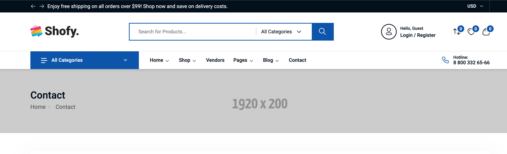

# Breadcrumb

Breadcrumb is a navigation aid that helps users to know where they are on a website. It is usually displayed at the top of a page.

## Enable or disable the breadcrumb

Go to **Appearance → Theme Options → Breadcrumb** and toggle **Enable breadcrumb?**. When it is off, the breadcrumb trail is hidden on every page.

Amerce renders the page title and breadcrumb on a plain background (no background image option). The homepage never shows a breadcrumb, and product, blog post and vendor store pages render their own title bar with the breadcrumb built in.
