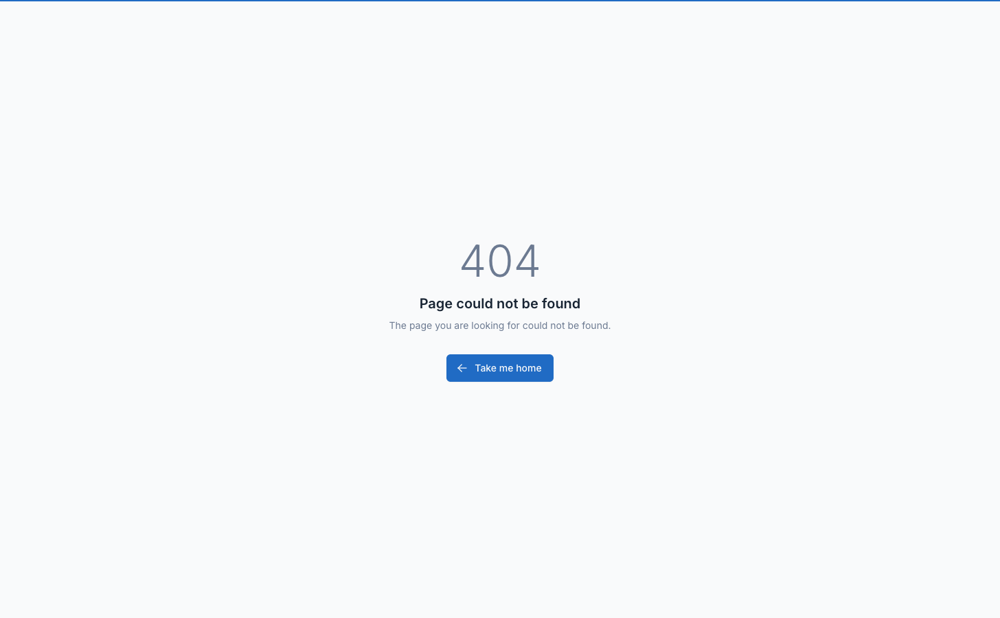

# Digital Products

Digital products allow you to sell downloadable files and software licenses. Customers receive download links and license codes automatically after purchase.

## Overview

Digital product features:

1. **Downloadable Files** - PDF, audio, video, software, etc.
2. **License Codes** - Unique keys for software activation
3. **Auto-Delivery** - Instant access after payment
4. **Auto-Complete** - Optionally complete digital-only orders once paid

## Enable Digital Products

Navigate to `Settings` -> `Ecommerce` -> `Digital Products`.



### Configuration Options

| Setting | Description | Default |
|---------|-------------|---------|
| **Is it enabled to support digital products** | Turn on/off digital product features | Off |
| **Allow guest checkout for digital products** | Let guests purchase without account (download links sent by email) | Off |
| **Disable physical product** | Sell digital products only; physical options are hidden | Off |
| **Enable license codes for digital products** | Show license code features in product forms | Off |
| **Hide used license codes in product form** | Keep the product's license code table clean | Off |
| **Auto-complete digital orders after payment** | Mark digital-only orders completed once paid | Off |

Click **Save** after configuration.

::: warning
Digital products require a properly configured email system. Customers receive download links via email.
:::

## Creating Digital Products

### Step 1: Create Product

Navigate to `Ecommerce` -> `Products`, open the **Create** dropdown and choose **Digital**.

1. Enter product details (name, description, price)
2. Configure pricing and settings
3. Click **Save**

### Step 2: Upload Digital Files

In the product edit page:

1. Scroll to **Digital attachments** section
2. Click **Add Attachment** (or **Add external link**)
3. Choose upload method:

**Option 1: Upload File**
- Click **Browse**
- Select file from computer
- System uploads and stores securely

**Option 2: External Link**
- Click **Add external link** and enter the download URL
- For files hosted elsewhere (Google Drive, Dropbox, etc.)

4. Configure file settings:
   - **File Name** - Display name for customer
   - **File Size** - Auto-detected or manual entry
5. Repeat for multiple files
6. Click **Save**

::: tip
For large files (>100MB), use external links to cloud storage instead of direct upload.
:::

### Supported File Types

Common file types for digital products:

| Category | Extensions |
|----------|-----------|
| Documents | PDF, DOC, DOCX, TXT, XLS, XLSX |
| Images | JPG, PNG, GIF, SVG, AI, PSD |
| Audio | MP3, WAV, FLAC, AAC |
| Video | MP4, AVI, MOV, MKV |
| Archives | ZIP, RAR, 7Z |
| Software | EXE, DMG, APK (use with caution) |

::: warning
Executable files (.exe, .dmg) may be blocked by some email providers. Consider providing download links via customer account instead.
:::

## License Code System

For software and activation-based products.

### Enable License Codes

1. Navigate to `Settings` -> `Ecommerce` -> `Digital Products`
2. Enable **Enable license codes for digital products**
3. Click **Save**

### Adding License Codes to Products

Edit the digital product, enable **Enable license code assignment for this product**, then pick a **License Code Assignment Method**:

**Method 1: Auto Generate**

- **Auto Generate (System generates codes automatically)** - a code is generated for each purchase

**Method 2: Pick from List**

- **Pick from List (Use pre-entered codes)** - in the product's **License Codes** section:
  1. Click **Add License Code** to enter codes one by one, or
  2. Click **Generate License Codes** and set **Quantity** and **Format** (or a **Custom Pattern**: `#` digit, `A` uppercase, `a` lowercase)

If the list runs out, customers receive auto-generated codes.

**Method 3: Bulk Import**

From the product's **Manage License Codes** page, open the actions dropdown and choose **Import** (opens **Import Product License Codes**):

1. Download the example file
2. Fill in columns:
   ```csv
   product_id,license_code
   123,XXXX-XXXX-XXXX-XXXX
   123,YYYY-YYYY-YYYY-YYYY
   ```
3. Upload the file
4. Click **Import**

### License Code Status

| Status | Description |
|--------|-------------|
| **Available** | Not yet assigned |
| **Used** | Assigned to customer |

::: tip
Generate more license codes than expected sales. System automatically assigns available codes on purchase.
:::

## Download Settings

There are no per-product download limit or download expiry settings. Customers can download purchased files from their account for as long as the order exists.

## Customer Download Process

### Purchase Flow

1. **Customer purchases** digital product
2. **Payment confirmed** - Order status = Completed
3. **System sends email** with:
   - Download links for each file
   - License codes (if enabled)
   - Access instructions
4. **Customer downloads** from email or account

### Download from Account

Customers can access downloads from their account:

1. Navigate to `My Account` -> `Downloads`
2. View all purchased digital products
3. Click **Download** button
4. View license codes (if applicable)

### Download Link Security

Download links are:
- **Unique per customer** - Cannot be shared
- **Time-limited** - Expire after set days
- **Count-limited** - Track download attempts
- **Logged** - Monitor download activity

## Email Notifications

### Download Email Template

Customize the download email:

1. Navigate to `Settings` -> `Email`
2. Find **Download digital products** (or **Digital product license codes** for license code emails)
3. Edit template variables:

| Variable | Description |
|----------|-------------|
| `customer_name` | Customer's name |
| `customer_phone`, `customer_address` | Customer contact |
| `payment_method` | Payment method |
| `order_note` | Order note |
| `order_id` | Order reference number |
| `digital_product_list` | HTML list of purchased digital products with download links |
| `digital_products` | Digital products data (for custom loops) |

4. Click **Save**

### Test Email

1. Create test order
2. Mark as completed
3. Check email delivery
4. Verify download links work

## Managing License Codes

License codes are managed per product: edit the product and use its **License Codes** section or the **Manage License Codes** page (there is no separate License Codes menu).

### License Code Actions

| Action | Description |
|--------|-------------|
| **Add / Generate** | Add codes manually or generate them in bulk |
| **Edit** | Modify an available code |
| **Delete / Bulk delete** | Remove codes from the product |

::: warning
Used license codes cannot be edited or deleted.
:::

## Digital Product Variations

You can combine digital products with variations:

**Example:** Software with different editions

1. Create parent product (Software)
2. Add variations:
   - Basic Edition - $49
   - Pro Edition - $99
   - Enterprise Edition - $199
3. Upload different files per variation
4. Assign specific license codes per variation

Each variation can have:
- Different downloadable files
- Different license code pools
- Different pricing

## Digital + Physical Products

Customers can purchase both types in one order:

- **Digital products** - Deliver instantly
- **Physical products** - Ship separately
- **Order status** - Completed when physical items ship

## Refunds and Returns

### Refund Policy

Configure digital product refund policy:

1. Set return period (e.g., 7 days)
2. Track downloads before refund
3. Revoke access on refund

### Revoking Access

When refunding digital product:

1. Navigate to order
2. Issue refund
3. License codes have only **Available** and **Used** statuses; there is no automatic revoke. Handle access revocation manually (e.g., deactivate the key in your licensing system).

## Security Best Practices

### File Storage

1. **Use secure storage** - Files stored outside public directory
2. **Generate signed URLs** - Temporary, expiring links
3. **Monitor downloads** - Track suspicious activity
4. **Watermark files** - Add customer info to PDF/images

### License Code Security

1. **Use strong format** - UUID or complex alphanumeric
2. **One-time use** - Prevent code sharing
3. **Verify on activation** - Validate codes server-side
4. **Track activations** - Monitor how codes are used

### Preventing Piracy

1. **Limit downloads** - Reasonable download count
2. **Expire links** - Time-limited access
3. **Track sharing** - Monitor if multiple IPs download
4. **Legal notices** - Include copyright in files
5. **Regular audits** - Review download patterns

## Troubleshooting

### Customer can't download files

1. **Check order status** - Must be "Completed"
2. **Verify email sent** - Check order emails
3. **Check expiry** - Download link may have expired
4. **Check download count** - May have exceeded limit
5. **Generate new link** - Admin can create new download

### License code not received

1. **Check email delivery** - Verify email sent
2. **Check spam folder** - Email may be filtered
3. **Verify codes available** - Check license code pool
4. **Manual assignment** - Admin can assign code manually

### Download link expired

**Admin Solution:**
1. Navigate to order
2. Click **Resend download links**
3. System generates fresh links with new expiry

**Customer Solution:**
1. Contact support
2. Request new download link

### File upload fails

1. **Check file size** - Verify server upload limits
2. **Check permissions** - Ensure `storage/app` is writable
3. **Use external link** - For very large files
4. **Check timeout** - Increase `max_execution_time`

## Import/Export Digital Products

### Export

Include digital product data:

```csv
product_type,generate_license_code
digital,1
```

### Import

Specify product type:

```csv
name,product_type,generate_license_code
Digital Product,digital,1
```

Upload files and license codes manually after import.

## Analytics & Reporting

Track digital product performance:

Navigate to `Ecommerce` -> `Reports`:

**Metrics:**
- Download count per product
- License code usage rate
- Most downloaded products
- Download errors/failures
- Average downloads per customer

## Best Practices

1. **Test thoroughly** - Purchase and download before launch
2. **Set reasonable limits** - Balance access and security
3. **Use cloud storage** - For large files
4. **Backup files** - Maintain copies of all digital products
5. **Monitor downloads** - Watch for unusual patterns
6. **Update files** - Keep digital products current
7. **Clear instructions** - Include usage guides
8. **Prompt delivery** - Ensure instant access
9. **Quality files** - Provide professional, working files
10. **Customer support** - Help with download issues quickly

## Example: Complete Setup

**Product:** Premium WordPress Theme

**Configuration:**
1. **Product Type:** Digital
2. **Price:** $59
3. **Files:**
   - Theme ZIP file (15MB)
   - Documentation PDF (2MB)
   - Video tutorial link (external)
4. **License Codes:** 100 pre-generated codes
5. **Download Settings:**
   - Maximum downloads: 5
   - Expiry: 30 days
6. **Email:** Custom template with installation instructions

**Customer Experience:**
1. Purchase theme ($59)
2. Payment confirmed
3. Receive email with:
   - Download button for ZIP
   - Download button for PDF
   - Video tutorial link
   - License code: `XXXX-XXXX-XXXX-XXXX`
4. Downloads ZIP, activates with license code
5. Can re-download 4 more times within 30 days
