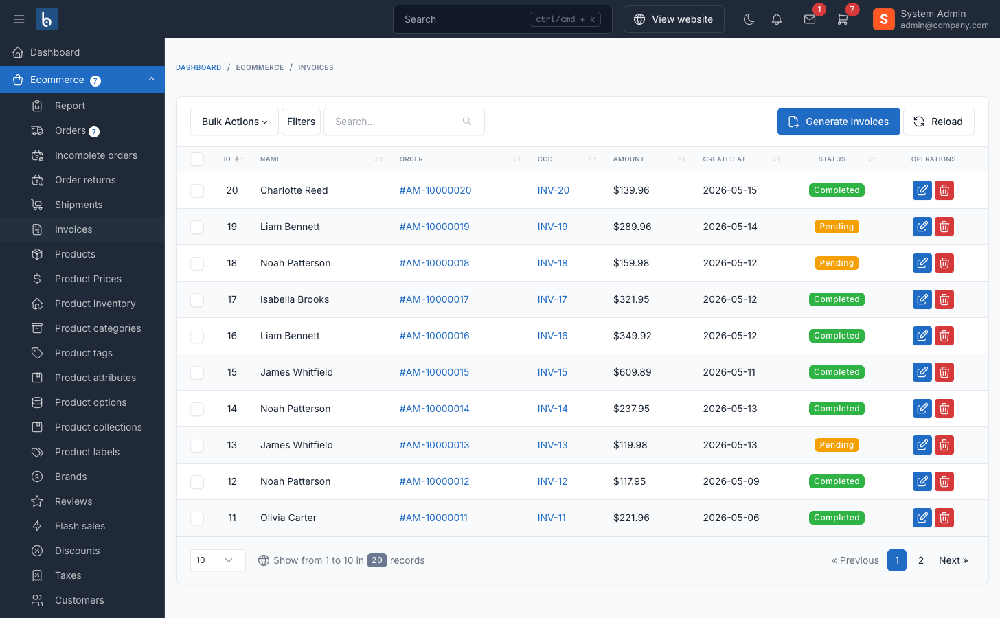
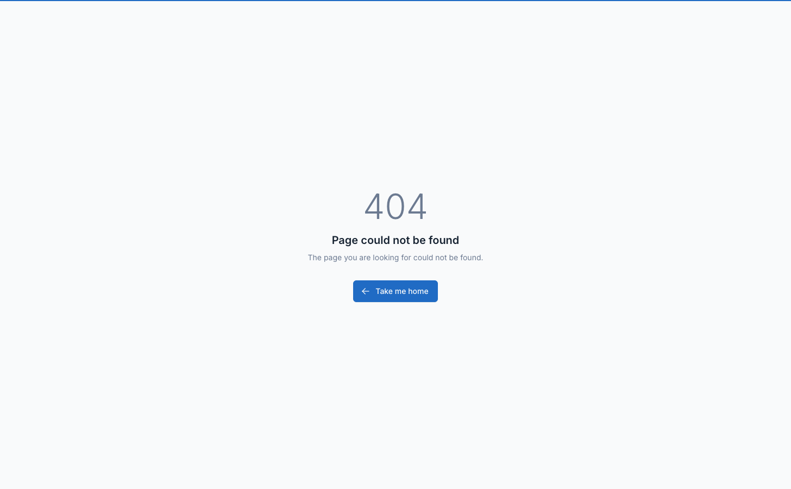

# Invoices

The invoice system generates professional, branded invoices for orders with customizable templates and comprehensive order details.

## Overview

Amerce's invoice system includes:

- **Automatic generation** - Create invoices when orders are placed
- **Manual generation** - Generate invoices on-demand for any order
- **Customizable templates** - Multiple invoice layouts with theme customization
- **PDF export** - Download and print invoices
- **Company branding** - Add logo, company details, and tax information
- **Invoice numbering** - Unique invoice codes with a custom prefix
- **Multi-currency support** - Display amounts in order currency
- **Tax breakdown** - Detailed tax components by rate

## Accessing Invoices

Navigate to `Ecommerce` -> `Invoices` in the admin panel.



The invoices table displays:
- Invoice code
- Customer name
- Order code
- Amount
- Status
- Creation date
- Actions (View/Download/Delete)

## Invoice Generation

### Automatic Generation

Invoices are generated automatically when an order is placed at checkout or created by an admin. There is no setting to turn this off.

::: tip
Automatic generation ensures every order has an invoice without manual intervention.
:::

### Manual Generation

To manually generate an invoice for an order:

**Method 1: From Order Details**
1. Open order details page
2. Click **Generate Invoice** button
3. Invoice created and linked to order

**Method 2: Bulk Generation**
1. Navigate to `Ecommerce` -> `Invoices`
2. Click **Generate Invoices** button
3. System generates invoices for all finished (checked-out) orders without invoices
4. Confirmation shows number of invoices created

::: warning
Generate Invoice button only appears on orders without existing invoices.
:::

## Invoice Availability

Invoices are available to customers when:

1. **Invoice exists** - Invoice has been generated for the order
2. **Order is confirmed** - Order status is confirmed (unless setting allows unconfirmed)
3. **Not canceled** - Order status is not "Canceled"

### Invoice Until Confirmed Setting

At `Settings` -> `Ecommerce` -> `Invoices`:

**Disable order invoice until order confirmed**
- When enabled: Customers cannot view invoices until admin confirms order
- When disabled: Customers can view invoices immediately after generation

Use this to:
- Verify order details before sharing invoice
- Prevent premature invoice distribution
- Control customer access timing

## Viewing & Downloading Invoices

### From Order Details

1. Open order details page
2. Scroll to invoice section
3. Click action:
   - **View** - Opens invoice in browser
   - **Download** - Downloads PDF file
   - **Print** - Opens print dialog

### From Invoice List

1. Navigate to `Ecommerce` -> `Invoices`
2. Find invoice in list
3. Click **View** or **Download** icon

### Customer Access

Customers can view/download invoices from:
- Order confirmation email (if invoice is generated)
- Order details in their account
- Order tracking page (if accessible)

::: tip
Invoices are accessible via secure URLs that include order token for authentication.
:::

## Invoice Information

### Standard Fields

Every invoice includes:

**Invoice Header**
- Invoice code (unique identifier)
- Invoice date
- Order code (reference)
- Payment status

**Company Information** (Your store)
- Company name
- Company logo
- Company address
- Company phone
- Company email
- Tax ID (if configured)

**Customer Information**
- Customer name
- Customer email
- Customer phone
- Shipping address
- Tax ID (if provided by customer)

**Payment Information**
- Payment method
- Transaction ID (if available)
- Payment status

**Order Items**
- Product name with SKU
- Product options/variations
- Quantity
- Unit price
- Tax amount per item
- Line total

**Amounts Summary**
- Subtotal (before tax and shipping)
- Tax amount (by tax class)
- Shipping cost
- Discount amount (if applied)
- **Total amount**

**Additional Details**
- Order notes/description
- Coupon code (if used)
- Shipping method
- Payment method

## Invoice Configuration

Navigate to `Settings` -> `Ecommerce` -> `Invoices` to configure:



### Basic Settings

| Setting | Description | Example |
|---------|-------------|---------|
| **Invoice code prefix** | Text before invoice number | "INV-" |
| **Disable order invoice until order confirmed** | Hide until order confirmed | Enabled |
| **Using custom font for invoice** / **Invoice font family** | Google Font for PDF invoices (Latin only) | Off |
| **Add language support** | Extra character sets: Only Latin languages, Arabic, Bengali, Chinese | Only Latin languages |
| **Invoice processing library** | PDF engine: DomPDF (faster) or mPDF (more languages) | DomPDF |
| **Enable invoice stamp** | Add a "PAID" stamp when the order payment is completed | Off |
| **Date format** | How dates show on invoices | `F d, Y` |

**Invoice Code Format:**
```
[PREFIX][NUMBER]

Examples:
INV-000123
2024-001
```

### Company Information

Configure your store's information shown on invoices at `Settings` -> `Ecommerce` -> `Invoices`:

- **Company name**
- **Company address** (with country, state, city and zipcode)
- **Company email**
- **Company phone**
- **Company tax ID**
- **Company logo**

::: tip Logo Recommendations
- Format: PNG or JPG
- Dimensions: 200x80 pixels optimal
- Background: Transparent PNG preferred
- Size: Under 500KB
:::

## Invoice Templates

### Available Templates

The template editor lists one template per document type:

1. **Order Invoice** - Invoices for customer orders
2. **Subscription invoice** - Vendor subscription invoices (Marketplace)
3. **Payout Invoice** - Vendor withdrawal invoices (Marketplace)

Navigate to `Settings` -> `Ecommerce` -> `Invoice Template` to:
- Preview a template
- Switch between templates
- Customize template HTML
- Add custom CSS

### Customizing Templates

To customize invoice appearance:

1. Navigate to `Settings` -> `Ecommerce` -> `Invoice Template`
2. Select template to customize
3. Edit template:
   - **HTML Content** - Modify layout and structure
   - **Custom CSS** - Add styling rules
4. Use template variables for dynamic content
5. Click **Preview** to test changes
6. Save customization

**Available Template Variables:**

| Variable | Description |
|----------|-------------|
| `invoice.*` | Invoice data from the database, e.g. `invoice.code`, `invoice.amount`, `invoice.items` |
| `logo_full_path` | Site logo full URL |
| `company_logo_full_path` | Company logo full URL |
| `site_title` | Site title |
| `company_name`, `company_address`, `company_country`, `company_state`, `company_city`, `company_zipcode` | Company name and address |
| `company_phone`, `company_email`, `company_tax_id` | Company contact and tax ID |
| `customer_name`, `customer_email`, `customer_phone` | Customer contact |
| `customer_address`, `customer_address_line`, `customer_country`, `customer_state`, `customer_city`, `customer_zip_code` | Customer address |
| `payment_method`, `payment_status`, `payment_description` | Payment details |
| `html_attributes`, `body_attributes` | HTML and body tag attributes |

The editor shows the full variable list next to the template content.

For complete template customization, edit the invoice template in the admin settings as described above.

### Resetting Templates

To restore default template:

1. Navigate to invoice templates
2. Select customized template
3. Click **Reset to default**
4. Confirm reset
5. Customizations removed, original template restored

::: warning
Resetting deletes all customizations. Export your custom template before resetting if you want to keep changes.
:::

## Invoice Status

Invoice status tracks payment state:

| Status | Description |
|--------|-------------|
| **Pending** | Payment not yet received |
| **Processing** | Payment is being processed |
| **Completed** | Payment completed |
| **Canceled** | Invoice/order canceled |

Status is synchronized with:
- Order status
- Payment status
- Refund state

## Tax Information on Invoices

### Tax Breakdown

Invoices display tax information:

**Per-item tax:**
- Tax amount for each product line
- Tax rate applied
- Tax class name

**Total tax:**
- Subtotal by tax rate
- Tax class names
- Combined tax total

**Tax components:**
- GST/VAT breakdown
- Regional tax components
- Multiple tax rates summed

### Customer Tax ID

If customer provides business tax information:

- Company tax code/VAT number
- Company name
- Company address
- Company email

This information appears in dedicated section on invoice.

## Multi-Currency Invoices

Invoices display amounts in the currency used for the order:

- Order currency detected from customer session
- All amounts shown in that currency
- Currency symbol and code included
- Exchange rates (if applicable) stored with order

## Invoice Management

### Editing Invoices

Invoices are automatically generated from order data and cannot be directly edited.

To modify invoice:
1. Edit the source order details
2. Delete the invoice
3. Regenerate invoice from order

### Deleting Invoices

To delete an invoice:

1. Navigate to `Ecommerce` -> `Invoices`
2. Find invoice to delete
3. Click **Delete** icon
4. Confirm deletion

::: warning
Deleting an invoice removes it permanently. You can regenerate from the order if needed.
:::

### Regenerating Invoices

To regenerate an invoice:

1. Delete existing invoice (if any)
2. Open order details
3. Click **Generate Invoice** button
4. New invoice created with current order data

## Email Delivery

Invoices can be sent to customers via email:

### Invoice Payment Created Email

Amerce ships an **Invoice payment created** email template (disabled by default):

1. Navigate to `Settings` -> `Email`
2. Find **Invoice payment created** in the Ecommerce templates
3. Enable it and edit the content if needed
4. Available variables: `customer_name`, `invoice_code`, `invoice_link`

When the payment is completed, the invoice PDF is attached to this email automatically.

## Printing Invoices

### Single Invoice

To print an invoice:

1. View invoice in browser
2. Click **Print** button
3. Browser print dialog opens
4. Select printer or save as PDF
5. Print/save

### Bulk Printing

To print multiple invoices:

1. Export invoices list to CSV
2. Use third-party tool for bulk PDF generation
3. Or print individually from invoice list

## Invoice Security

Invoices include security features:

**Access Control:**
- Admin authentication required
- Customer access via order token
- Time-limited access URLs

**Data Protection:**
- Secure PDF generation
- Encrypted customer data
- HTTPS delivery required

**Privacy:**
- Customer-specific information
- No public listing of invoices
- Restricted search/filtering

## Troubleshooting

### Invoice Not Generating

Check:
- Order is finished (`is_finished = true`)
- Invoice doesn't already exist for order
- Queue worker is running (invoice generation runs as a queued listener)
- No errors in Laravel logs

### Invoice Not Visible to Customer

Verify:
- Invoice has been generated
- Order is confirmed (if "disable until confirmed" is on)
- Order is not canceled
- Customer has correct order URL/token

### Wrong Company Information

Update:
- Check `Settings` -> `Ecommerce` -> `Invoices` for company info and tax ID
- Regenerate invoice after updating
- Clear application cache

### Template Customization Not Showing

Ensure:
- Customization was saved
- Cache is cleared (`php artisan cache:clear`)
- Correct template is selected
- Browser cache is refreshed

### PDF Download Failing

Check:
- The selected **Invoice processing library** (DomPDF or mPDF) works on your server
- PHP memory limit is sufficient
- Temp directory is writable
- No logo image loading errors

## Advanced Features

### Custom Invoice Numbers

For sequential numbering across years:

1. Set prefix with year: `2024-`
2. Numbers continue: `2024-001`, `2024-002`
3. Change prefix annually: `2025-`

### Invoice API

Access invoices programmatically:

```php
use Botble\Ecommerce\Models\Invoice;
use Botble\Ecommerce\Facades\InvoiceHelper;

// Get invoice
$invoice = Invoice::find($id);

// Generate invoice
InvoiceHelper::store($order);

// Download PDF
InvoiceHelper::downloadInvoice($invoice);

// Stream PDF
InvoiceHelper::streamInvoice($invoice);
```

### Webhooks

Send invoice data to external systems:

There is no invoice webhook. `Settings` -> `Ecommerce` -> `Webhooks` offers order-level URLs (order placed, order updated, shipping status updated, order completed, order cancelled, payment status updated, abandoned cart). Use **Order placed** to react to new orders, which is when invoices are created.

## Best Practices

1. **Run a queue worker** - Automatic invoice generation is queued

2. **Customize company info** - Complete all company fields for professional appearance

3. **Test templates** - Preview customizations before deploying

4. **Use proper branding** - Upload high-quality logo, match brand colors

5. **Include payment terms** - Add payment terms to template if needed

6. **Archive invoices** - Export invoice data periodically for accounting

7. **Keep templates simple** - Avoid complex layouts that may not render properly

8. **Test PDF generation** - Verify PDFs render correctly on different devices

9. **Backup customizations** - Save custom template code before updating

10. **Monitor errors** - Check logs for invoice generation failures

## Frequently Asked Questions

### Can I edit an invoice after generation?

No. Invoices reflect order data at generation time. Edit the order and regenerate the invoice if needed.

### Are invoices legally valid?

Invoices include all standard required information. Check with your accountant for specific legal requirements in your jurisdiction.

### Can I create invoices without orders?

No. Invoices are always linked to orders. Create an order first, then generate its invoice.

### How do I add my tax ID to invoices?

Add it in **Company tax ID** at `Settings` -> `Ecommerce` -> `Invoices`. It will appear in the company information section.

### Can customers print invoices?

Yes. Customers can view and print invoices from their order details page.

### What format are invoices stored in?

Invoices are stored as database records. PDFs are generated on-demand when viewed or downloaded.

### Can I change invoice numbers?

Invoice numbers are auto-generated and cannot be changed after creation. Set the prefix before generating.

### How long are invoices kept?

Invoices are kept indefinitely unless manually deleted. They remain as long as the order exists.

## Related Documentation

- [Order Management](/amerce/usage-order-management) - Managing orders that generate invoices
- [Tax Configuration](/amerce/usage-tax) - Setting up tax rates shown on invoices
- [Payment Gateways](/amerce/usage-payment-gateways) - Payment methods displayed on invoices
