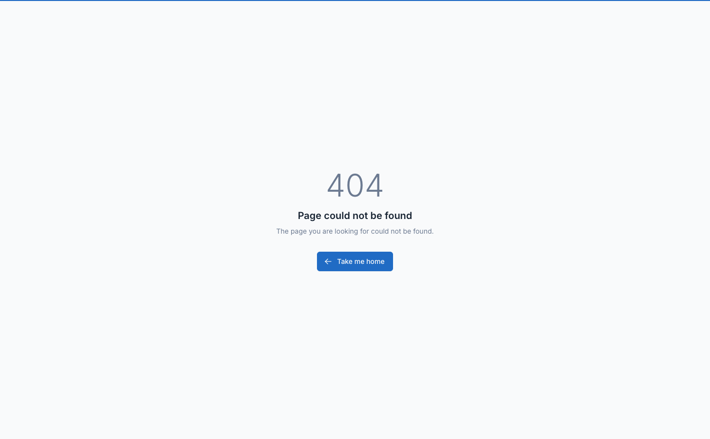

# Marketplace Commissions

The commission system allows the marketplace platform to earn a percentage or fixed fee from vendor sales. Commissions can be set globally, per category, or per vendor.

## Overview

When a customer purchases from a vendor:

1. **Order is placed** and payment is received
2. **Commission is calculated** based on configured rates
3. **Platform fee is deducted** from vendor's earnings
4. **Vendor receives net amount** (order total - commission)
5. **Revenue is tracked** for both platform and vendor

## Commission Settings

Navigate to `Settings` -> `Ecommerce` -> `Marketplace` to configure commission rates.



### Default Commission Fee

| Setting | Description |
|---------|-------------|
| **Default commission fee (%)** | Percentage charged on all vendor sales (0-100%) |
| **Fixed commission fee (per order)** | Flat amount charged once per vendor order on top of the percentage (e.g. to cover a gateway's fixed €0.25). `0` disables |

These settings apply when **Marketplace mode** is **Commission based** or **Subscription + commission** (other modes: **Subscription based**, where vendors buy a plan and no commission is taken).

This is the global commission rate applied to all products unless overridden by category-specific rates.

**Example:**
- Default commission: 10%
- Product price: $100
- Platform commission: $10
- Vendor receives: $90

### Category-Based Commissions

Enable category-specific commission rates to charge different percentages for different product categories.

1. **Enable commission fee for each category** - Toggle ON
2. **Add category commission rules** - Click "Add new fee"
3. **Select categories** - Choose one or more product categories
4. **Set commission percentage** - Enter rate for those categories

::: tip
Category commissions override the default commission rate. If a product belongs to a category with a specific commission rate, that rate is used instead of the default.
:::

**Example Configuration:**

| Categories | Commission Rate |
|-----------|-----------------|
| Electronics, Phones | 15% |
| Fashion, Clothing | 8% |
| Books | 5% |
| All others | 10% (default) |

**How it works:**
- iPhone 15 (in "Phones" category) → 15% commission
- Designer Shirt (in "Fashion" category) → 8% commission
- Cookbook (in "Books" category) → 5% commission
- Kitchen Gadget (no specific category) → 10% (default)

### Per-Vendor Commission Rates

::: warning
There is no per-vendor commission field on the store form. In **Subscription + commission** mode, a vendor's subscription plan can override the commission rates for that vendor; otherwise default and category-based rates apply.
:::

## Commission Calculation

### Basic Calculation

```
Commission Amount = Product Price × Commission Percentage ÷ 100
Vendor Earning = Product Price - Commission Amount
```

### Multi-Item Orders

For orders with multiple products:

```
For each product:
  - Calculate commission based on product's category
  - Sum all commissions
Total Platform Fee = Sum of all product commissions
Total Vendor Revenue = Order Total - Total Platform Fee
```

### Example Order Calculation

**Order details:**
- Product A: $100 (Electronics - 15% commission)
- Product B: $50 (Fashion - 8% commission)
- Product C: $30 (Books - 5% commission)

**Commission breakdown:**
- Product A commission: $100 × 15% = $15
- Product B commission: $50 × 8% = $4
- Product C commission: $30 × 5% = $1.50

**Totals:**
- Order total: $180
- Platform commission: $20.50
- Vendor receives: $159.50

## Revenue Tracking

### Admin Revenue Reports

Navigate to `Marketplace` -> `Stores`, then open a store to see its revenue list.

The revenue table shows:

| Column | Description |
|--------|-------------|
| **Customer** | Vendor name |
| **Order ID** | Related order number |
| **Sub Amount** | Order subtotal before commission |
| **Fee** | Platform commission amount |
| **Amount** | Net amount credited to vendor |
| **Current Balance** | Vendor balance after transaction |
| **Currency** | Transaction currency |
| **Type** | Revenue type (add amount, subtract amount, order return, subscription fee) |
| **Description** | Transaction notes |
| **User** | Admin who created the record (if manual) |
| **Created At** | Transaction date |

### Viewing Vendor Revenues

**Per vendor:**
1. Go to `Marketplace` -> `Stores`
2. Open the store to view its revenue history

### Vendor Revenue Dashboard

Vendors view their earnings at: `Vendor Dashboard` -> `Revenues`

Vendors see:
- Total revenue earned
- Commission fees paid
- Net earnings
- Current withdrawable balance
- Revenue history by order

## Manual Revenue Adjustments

Admins can manually create revenue records for:
- Refunds
- Credits
- Corrections
- Bonuses

::: warning
Manual revenue adjustments should be used carefully as they directly affect vendor balances and signature verification.
:::

## Commission on Different Order Types

### Regular Orders

Standard commission calculation applies.

### Partial Refunds

When an order is partially refunded:
- Commission is recalculated based on remaining order value
- Vendor balance is adjusted accordingly
- Revenue record is updated or new adjustment created

### Full Refunds

When an order is fully refunded:
- Commission is reversed
- Vendor balance is credited back
- Revenue record reflects the reversal

### Shipping Fees

Shipping fee commission depends on marketplace settings:

- **Charge shipping per vendor = OFF**: Platform handles shipping, no commission on shipping
- **Charge shipping per vendor = ON**: Shipping fee goes to vendor, commission may apply based on configuration

## Revenue Reports

### Platform Revenue Summary

Track total marketplace earnings:

1. Navigate to `Marketplace` -> `Reports`
2. View fees collected from all vendors
3. Filter by date range for period reports

**Key Metrics:**
- Total commissions earned
- Revenue by vendor
- Revenue by product category
- Average commission rate
- Top earning products/vendors

### Vendor Performance Reports

Identify top-performing vendors:

1. Go to `Marketplace` -> `Stores`
2. Sort by total revenue or total orders
3. Analyze commission revenue per vendor

## Commission Storage & Security

### Signature Verification

The system includes signature verification to prevent unauthorized balance manipulation:

| Setting | Description |
|---------|-------------|
| **Check valid signature** | Verify signature on vendor balance changes (recommended: ON) |

::: tip
Keep "Check valid signature" enabled in production to prevent fraud and data tampering.
:::

The signature is a hash of:
- Vendor balance
- Total fees paid
- Total revenue earned
- Customer ID

If signature verification fails, transactions are rejected.

## Troubleshooting

### Commission Not Being Calculated

1. Check default commission fee is set (not 0%)
2. Verify store is published and verified
3. Check order is marked as "finished"
4. Review revenue records for the order

### Wrong Commission Rate Applied

1. Verify category commission settings
2. Check product category assignment
3. Ensure category-based commissions are enabled
4. Review order items and their categories

### Vendor Balance Incorrect

1. Check all revenue records for that vendor
2. Verify no manual adjustments were made
3. Review withdrawal records
4. Check for refunded orders
5. Verify signature is valid (Settings -> Check valid signature)

### Signature Verification Error

**Error:** "Invalid signature"

**Cause:** Vendor balance, fees, or revenue were modified directly in database

**Solution:**
1. Temporarily disable "Check valid signature" in settings
2. Review and correct vendor balance
3. Re-enable signature verification
4. Future changes will generate new signatures

::: warning
Never edit `mp_vendor_info` table directly. Always use admin panel or proper API methods to avoid signature mismatches.
:::

## Best Practices

1. **Set competitive commission rates** - Research industry standards (typically 5-20%)
2. **Use category commissions strategically** - Lower rates for high-volume categories
3. **Monitor commission revenue** - Ensure platform sustainability
4. **Keep signature verification ON** - Prevents fraud and data corruption
5. **Regular audits** - Reconcile revenue records with actual payouts
6. **Clear communication** - Inform vendors of commission rates before registration
7. **Document rate changes** - Keep records when updating commission percentages
8. **Test calculations** - Verify commission math with test orders before launch

## Frequently Asked Questions

### Can I charge a flat fee instead of percentage?

Yes. Set **Fixed commission fee (per order)** in the marketplace settings. It is charged once per vendor order on top of the percentage commission (set the percentage to `0` for a flat fee only).

### Can I set different rates for different vendors?

Not on the store itself. All vendors follow the default commission rate unless overridden by category-specific rates, or, in **Subscription + commission** mode, by the vendor's subscription plan.

### Do shipping fees have commission?

Depends on "Charge shipping per vendor" setting. Generally, shipping fees are passed to vendors without commission.

### What happens when a product is in multiple categories?

The system uses the first matching category commission rate found. Ensure your category commission rules don't overlap, or structure them hierarchically.

### Can vendors see commission rates?

Vendors can see the fee deducted from each order in their revenue dashboard, but commission percentages are not directly displayed. Consider communicating rates during vendor onboarding.
