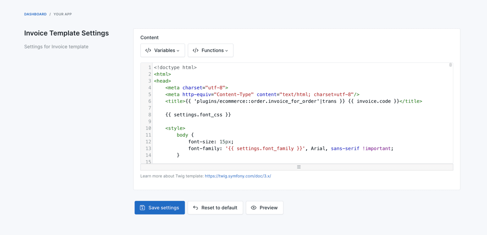

# Invoice Template

## Customize the template

There are two options to customize the invoice template:

### Customize in admin panel (recommended)

Go to `Settings` -> `Ecommerce` -> `Invoice Template` to customize the invoice template.



### Customize directly file

Copy file `platform/plugins/ecommerce/resources/templates/invoice.tpl` to `storage/app/templates/ecommerce/invoice.tpl` to start customizing it.

## Bangladesh font

To display Bangladesh text in invoice, need to use font **FreeSerif**.

- Download `FreeSerif.ttf` from the GNU FreeFont archive: https://ftp.gnu.org/gnu/freefont/freefont-ttf-20120503.zip (file `freefont-20120503/FreeSerif.ttf`).
- Upload `FreeSerif.ttf` to folder `/public`.
- Copy file `platform/plugins/ecommerce/resources/templates/invoice.tpl`
  to `storage/app/templates/ecommerce/invoice.tpl` to start customize.
- Change in CSS:

```blade
<style>
    @font-face {
        font-family: FreeSerif;
        src: url('{{ url('FreeSerif.ttf') }}');
    }
    
    body {
        font-size: 15px;
        font-family: FreeSerif, Arial, sans-serif !important;
    }
</style>
```

## Japanese font

- Option 1: Go to `Settings` -> `Ecommerce` -> `Invoices`, enable **Using custom font for invoice** and select `M PLUS Rounded 1c` in **Invoice font family**.

- Option 2: Customize invoice template like this:

```html
<link rel="preconnect" href="https://fonts.googleapis.com">
<link rel="preconnect" href="https://fonts.gstatic.com" crossorigin>
<link href="https://fonts.googleapis.com/css2?family=M+PLUS+Rounded+1c&display=swap" rel="stylesheet">

<style>

    body {
        font-size: 15px;
        font-family: 'M PLUS Rounded 1c', 'DejaVu Sans', Arial, sans-serif !important;
    }

    ...
    .bold, strong {
        font-weight: normal;
    }

    ...
    .total {
        color: #fb7578;
        font-weight: normal
    }

    ...
</style>
```

- Option 3: Using font **CyberCJK**.

Customize template like this:

```CSS
@font-face {
    font-family: CyberCJK;
    src: url("http://eclecticgeek.com/dompdf/fonts/cjk/Cybercjk.ttf") format("truetype");
}

body {
    font-size: 15px;
    font-family: CyberCJK, Arial, sans-serif !important;
}
```

## Sinhala font

- Get a Sinhala Unicode TTF font and name the file `kaputaunicode.ttf`. The original download page (http://www.kaputa.com/slword/kaputaunicode.htm) did not respond when this page was last checked.
- Upload `kaputaunicode.ttf` to folder `/public`.
- Copy file `platform/plugins/ecommerce/resources/templates/invoice.tpl`
  to `storage/app/templates/ecommerce/invoice.tpl` to start customize.
- Change in CSS:

```blade
<style>
    @font-face {
        font-family: kaputaunicode;
        src: url('{{ url('kaputaunicode.ttf') }}');
    }
    
    body {
        font-size: 15px;
        font-family: kaputaunicode, Arial, sans-serif !important;
    }
</style>
```