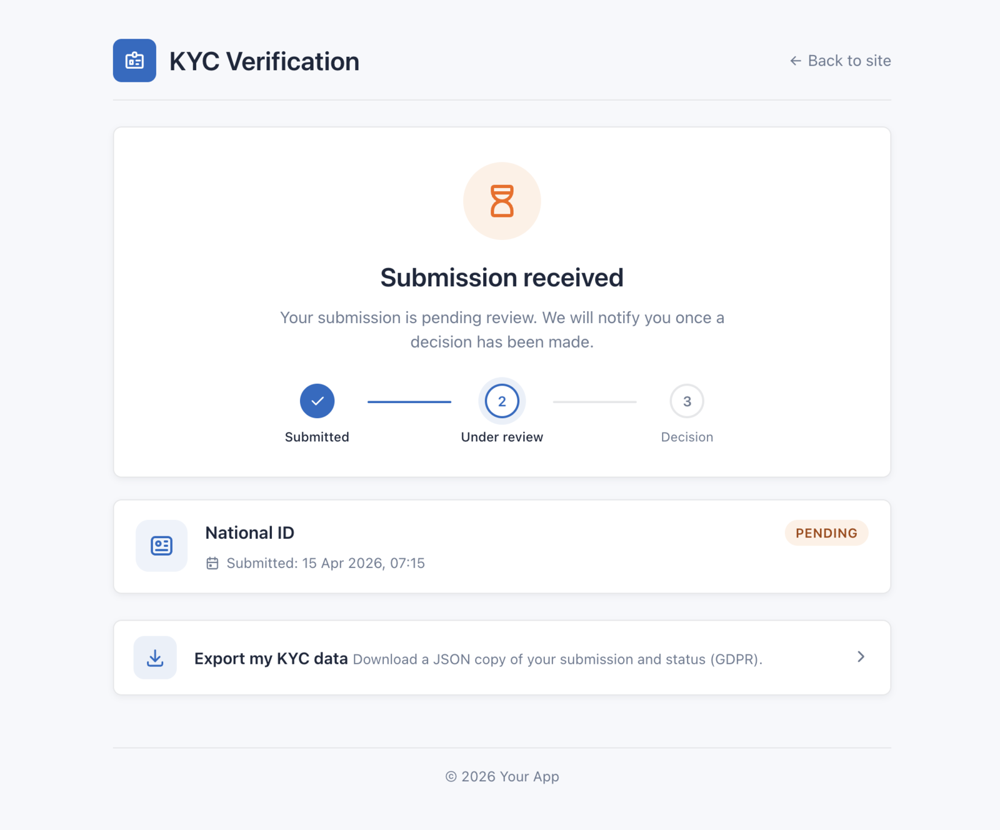

# Approve & Reject

The **submission detail page** is where admins actually decide a case. Reach it by clicking any row in the [review queue](./review-queue.md).

## Page layout

The detail page is split into three main regions:

1. **Subject card** — name, email, customer/store link, current KYC status badge.
2. **Documents card** — one preview per uploaded file (front image, back image, selfie, PDF). Each preview is a signed URL with a 15-minute TTL.
3. **Review panel** — approve / reject buttons, review note textarea, full submission history for this subject.

## File previews

Files are served through `kyc.file.show`, a guarded route that:

- Authenticates the request via **either** the admin web guard (permission `kyc.submissions.file`) or the subject-owner guard.
- Returns the file with security headers: `Content-Security-Policy: default-src 'none'`, `X-Content-Type-Options: nosniff`, `Cache-Control: no-store`, `Referrer-Policy: no-referrer`, `X-Frame-Options: DENY`.
- Expires after **15 minutes** — the page auto-refreshes signed URLs on each render, so refreshing the browser is enough to extend TTL.

::: tip
PDF documents open inline in the browser's PDF viewer. Image formats (JPG, PNG, WebP) render as `` thumbnails you can click to open full-size.
:::

## Approve

1. Click **Approve**.
2. A modal prompts for an optional internal note (visible only to admins).
3. Confirm.

On approval:

- `status` flips to `approved`.
- `reviewed_at` is set to now.
- `reviewed_by` is set to the current admin user.
- The subject's `hasApprovedKyc({scope})` helper starts returning `true`.
- A `KycApproved` event is dispatched.
- An approval email is sent to the subject with a CTA to the dashboard URL.
- If a webhook is configured, a signed `approved` payload is POSTed.

Requires permission: `kyc.submissions.approve`.

## Reject

1. Click **Reject**.
2. A modal prompts for a rejection reason (REQUIRED — this is what the customer will see).
3. Confirm.

On rejection:

- `status` flips to `rejected`.
- `reviewed_at`, `reviewed_by`, `review_note` are set.
- The subject's rejection counter in `kyc_subject_states` is incremented.
- If the counter reaches `kyc_max_rejections_before_lock` (default 3), the subject is auto-locked and any subsequent submit attempt redirects to the lockout page.
- A `KycRejected` event is dispatched.
- A rejection email is sent with the reason and a resubmit link.
- If a webhook is configured, a signed `rejected` payload is POSTed.

Requires permission: `kyc.submissions.reject`.

## Unverify (revoke approval)

Sometimes you need to revoke a previously-approved submission — e.g. the customer is suspected of document tampering or a compliance review requires a reverification.

1. Open an **approved** submission's detail page.
2. Click **Unverify**.
3. Confirm in the modal (required).

This:

- Deletes the subject's approved submission(s) of that type, together with their files.
- Clears the mirrored verified flag on host models (real-estate account, job-board company).
- Dispatches `KycUnverified` (no webhook is sent for it) and writes an audit log entry.

The subject can then submit a new verification.

Requires permission: `kyc.submissions.unverify`.

::: warning
Unverify is destructive — the files cannot be recovered once purged. Consider using Reject + manual retention instead if you only need a temporary hold.
:::

## Submission history

The right-hand panel shows **every** submission this subject has ever filed, regardless of status. Use it to spot repeat rejections, document-type changes, or long gaps between attempts.

Each history row links to its own detail page so you can compare the current upload against earlier attempts.

## Next step

- [Lockout & Unlock](./lockout.md) — reset the rejection counter
- [Email Notifications](./notifications.md) — customise what admins and subjects receive
