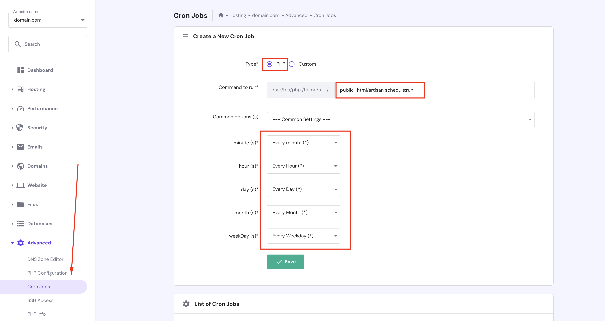
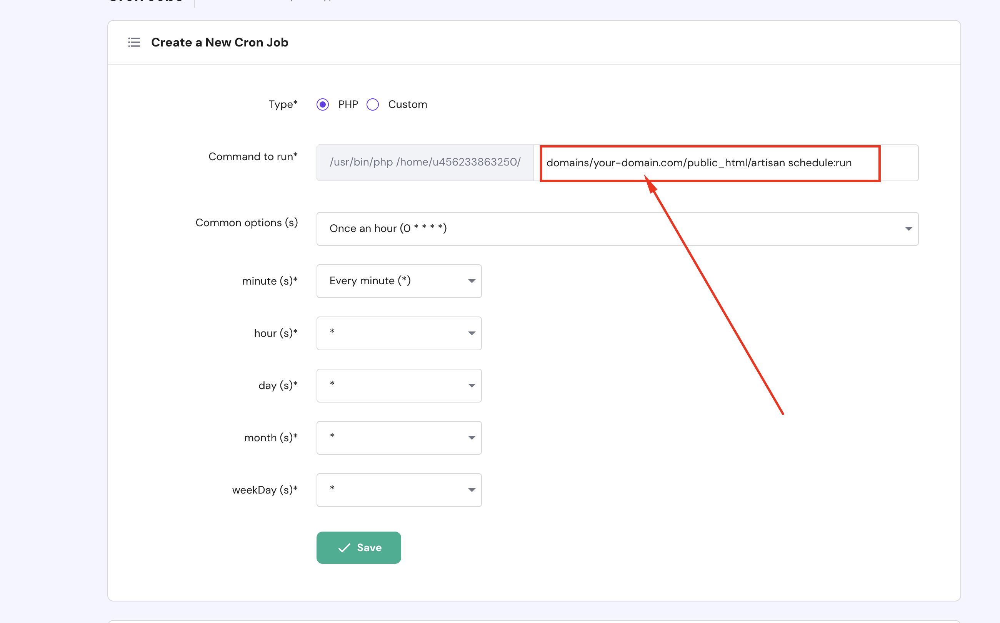
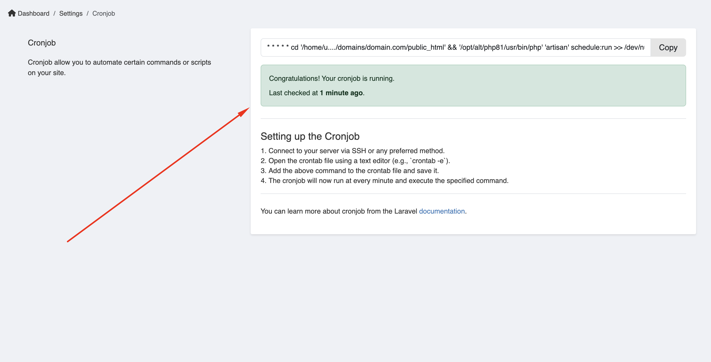

# Setup cronjob

Command:

```bash
* * * * * /usr/local/bin/php /path-to-your-project/artisan schedule:run >> /dev/null 2>&1
```

Check our Cronjob set up instruction in Admin -> Platform administration -> Cronjob.

## Available Commands

The plugin registers these schedules itself, so the single `schedule:run` cron entry above runs them — you do not
need to add them to `routes/console.php` or a separate crontab line:

| Command | Frequency | Purpose |
|---------|-----------|---------|
| `process-expirations` | Daily at 02:00 | Check and notify expirations |
| `process-auto-blacklist` | Hourly | Block abusive clients |
| `activity-log:clear` | Weekly | Empties the activity log table |
| `download-log:clear` | Weekly | Empties the update download history table |

::: warning Log tables are emptied weekly
`activity-log:clear` and `download-log:clear` truncate their whole table (not only old rows). Export anything you
need to keep before the weekly run.
:::

## For cPanel hosting

For setting up a cron job in cPanel, watch this video tutorial:

<iframe width="100%" height="400" src="https://www.youtube.com/embed/t5mjWGegE-g" title="YouTube video player" frameborder="0" allow="accelerometer; autoplay; clipboard-write; encrypted-media; gyroscope; picture-in-picture; web-share" allowfullscreen></iframe>

## For Hostinger.com

::: warning
Hostinger's cron field does not run the command through a shell, so `>> /dev/null 2>&1` is passed to Laravel as
arguments and the job fails with `No arguments expected for "schedule:run" command, got ">>"`.

On Hostinger, enter the command **without** the redirection:

```bash
/usr/local/bin/php /path-to-your-project/artisan schedule:run
```

Hostinger captures the output itself (visible via the **View Output** button), so the redirection is not needed.
:::

* Go to Dashboard -> Advanced -> Cron Jobs



If you have more than 1 domain on Hostinger, you need to select the domain you want to set up the cron job.



* Verify your cronjob is running or not.



## Manual Execution

You can also run commands manually:

```bash
# Process license expirations and send warnings
php artisan cms:license-manager:process-expirations

# Process auto-blacklist
php artisan cms:license-manager:process-auto-blacklist

# Clear activity logs
php artisan cms:license-manager:activity-log:clear

# Clear download logs
php artisan cms:license-manager:download-log:clear
```

## Via Admin Panel

Navigate to **License Manager → Run Manual Cron** and click **Run**. It runs the license expiration check and the
auto-blacklist check together and shows the result of each (the log-clear commands are not run from here).
