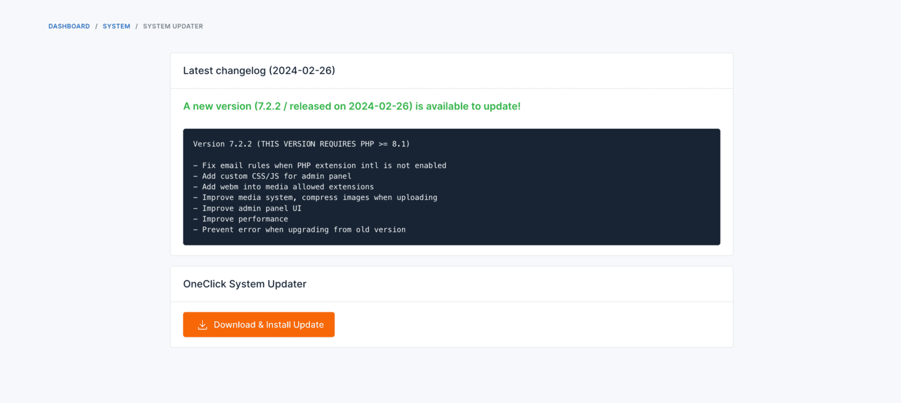
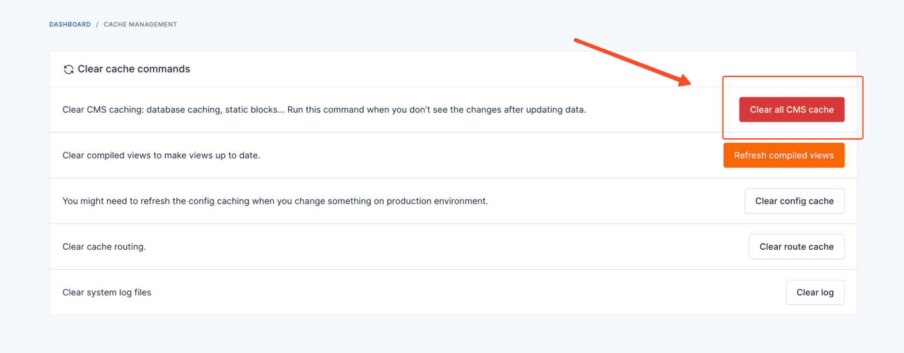
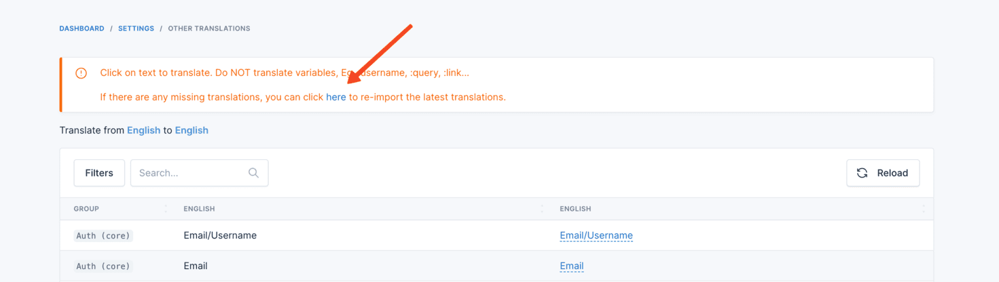

# Upgrade Guide

This guide will walk you through the process of upgrading License Manager. There are two ways to upgrade:

## Automatic Update

To update your product automatically, follow these steps:

1. Log in to your admin panel.
2. Go to `Platform Administration` -> `System Updater`.
3. If there is a new version available, you will see a `Download & Install Update` button. Click on it to start the
   automatic update process.



## Manual Update

This way is a bit more complex, but it gives you more control over the upgrade process. Here are the steps:

1. Download the latest version of the product from [Gumroad](https://botble.gumroad.com/l/license-manager).
2. Extract the downloaded file.
3. Upload the extracted files to your server, overwrite the following directories and files (and **never** the `.env`
   file in your project root):
   * `app`
   * `database`
   * `config`
   * `platform`
   * `public/themes`
   * `public/vendor`
   * `bootstrap`
   * `vendor`
   * `composer.json`
   * `composer.lock`
   * `public/index.php`
4. Update the database (see [Database Migrations](#database-migrations) below). **Do not skip this step.** New versions
   usually add or change tables and columns, and the automatic updater runs these migrations for you. A manual update
   does not.
5. Clear the cache by navigating to `Platform Administration` -> `Cache Management` and clicking on
   the `Clear all CMS cache` button.

   
6. Update the translations by going to `Settings` -> `Localization` -> `Other Translations` and click to the `here` link
   to update the translations.

   

### Database Migrations

::: danger Back up your database first
Migrations change your database structure. Take a full database backup before you run them on a live site.
:::

**With SSH access (recommended).** Run these commands from your project root:

```bash
php artisan migrate --force
php artisan cms:publish:assets
php artisan optimize:clear
```

- `migrate --force` runs only the migrations that are not yet recorded in your `migrations` table, so it is safe to
  run on a site with existing data. It covers the core, packages and every **activated** plugin. A plugin you activate
  later runs its own migrations when you activate it.
- `cms:publish:assets` copies the new CSS, JS and images from `platform/` into `public/vendor`.
- `optimize:clear` clears the config, route, view and application caches.

**Without SSH access.** Use the step-by-step buttons in the System Updater. Log in as a super admin and go to
`Platform Administration` -> `System Updater`. In the **Manual System Updater** box, click **Run** on these steps only,
in this order:

1. **Update databases** - runs the core, package and active plugin migrations.
2. **Publish core assets**
3. **Publish packages assets**

Skip **Download update files** and **Update system files**. You have already uploaded the new files yourself, and
running those two steps would download the update again and overwrite your files.

::: tip
The Manual System Updater box only appears when your site can reach the Botble update server. If it is missing, go to
`Plugins` -> `Installed Plugins`, deactivate all plugins, then activate them again. Activating a plugin runs that
plugin's migrations, but not the core and package migrations, so ask your hosting provider to run
`php artisan migrate --force` for you as well.
:::

::: tip Check for pending migrations
Run `php artisan migrate:status` to see which migrations have run. Any migration listed as **Pending** has not been
applied yet. A site can look fine with pending migrations until a page or feature touches the changed tables, so
check this on your staging copy before you deploy to production.
:::
