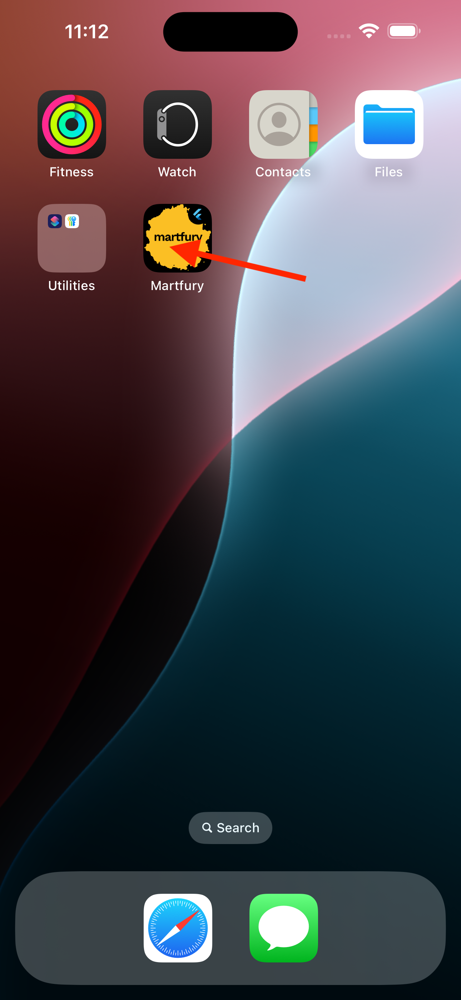

# Changing App Logo



The app icon for Android and iOS is generated from one source image with [flutter_launcher_icons](https://pub.dev/packages/flutter_launcher_icons), which is already configured in `pubspec.yaml`.

## Steps

1. Replace `assets/images/icon.png` with your logo.
   - Square PNG, 1024x1024 recommended
   - Keep the same file name

2. Generate the icons for all sizes:
   ```bash
   dart run flutter_launcher_icons
   ```
   This overwrites:
   - Android: `android/app/src/main/res/mipmap-*/launcher_icon.png`
   - iOS: all files in `ios/Runner/Assets.xcassets/AppIcon.appiconset/`

3. Remove the old build output and rebuild:
   ```bash
   flutter clean
   flutter run
   ```

::: tip
Old icons can still show up inside the `build/` folder until you run `flutter clean`. Those are leftover build files, not part of your app.
:::

## Configuration

The generator settings live in `pubspec.yaml`:

```yaml
flutter_launcher_icons:
  android: "launcher_icon"
  ios: true
  image_path: "assets/images/icon.png"
  min_sdk_android: 21
  remove_alpha_ios: true
```

The Android manifest already points to the generated icon, so no change is needed there:

```xml
<application
    android:icon="@mipmap/launcher_icon"
    ...
```

## Logo Inside the App

The app icon is separate from the logo shown inside the app (splash screen, header, profile page). That logo is `assets/images/logo.png` - see [Splash Screen](17_splash_screen.md).
