# Homepage Demos

Martfury ships with **12 homepage demos**. Each demo is a complete store: catalog, pages, menus, theme options and homepage content. You pick one during installation, or switch the look of an existing site from the theme options.

## Demos

| Demo | Preset ID | Header style | Footer style | Demo URL |
|------|-----------|--------------|--------------|----------|
| **Home 1 (Multipurpose)** | `default` | Default | Default | <https://martfury.botble.com> |
| **Marketplace 1** | `marketplace` | Marketplace 1 | Default | <https://martfury-marketplace.botble.com> |
| **Marketplace 2** | `marketplace-2` | Marketplace 2 | Site features + link columns | <https://martfury-marketplace-2.botble.com> |
| **Marketplace 3** | `marketplace-3` | Marketplace 3 | Site features + link columns | <https://martfury-marketplace-3.botble.com> |
| **Marketplace 4** | `marketplace-4` | Marketplace 4 | Site features + link columns | <https://martfury-marketplace-4.botble.com> |
| **Technology** | `technology` | Technology | Link columns + newsletter | <https://martfury-technology.botble.com> |
| **Electronic** | `electronic` | Electronic | Default | <https://martfury-electronic.botble.com> |
| **Furniture** | `furniture` | Furniture | Link columns + newsletter | <https://martfury-furniture.botble.com> |
| **Organic** | `organic` | Organic | Link columns + newsletter | <https://martfury-organic.botble.com> |
| **Auto parts** | `autopart` | Auto parts | Link columns + newsletter | <https://martfury-autopart.botble.com> |
| **Kids** | `kids` | Kids | Site features + link columns | <https://martfury-kids.botble.com> |
| **Medical** | `medical` | Medicine | Contact + link columns + newsletter | <https://martfury-medical.botble.com> |

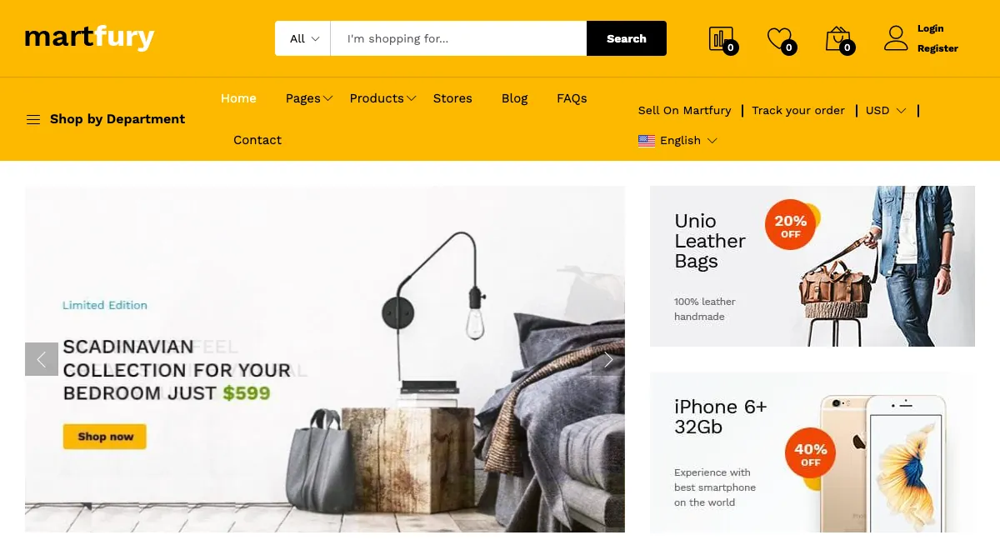

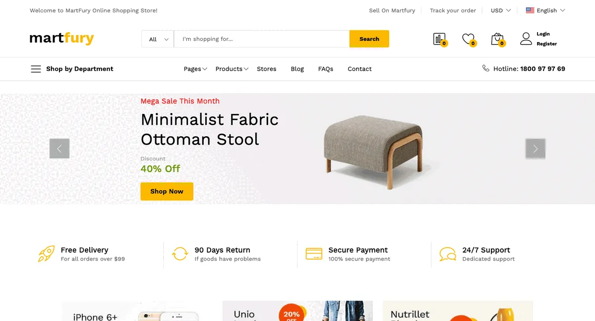

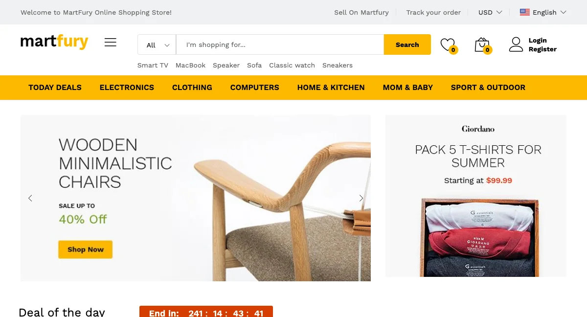

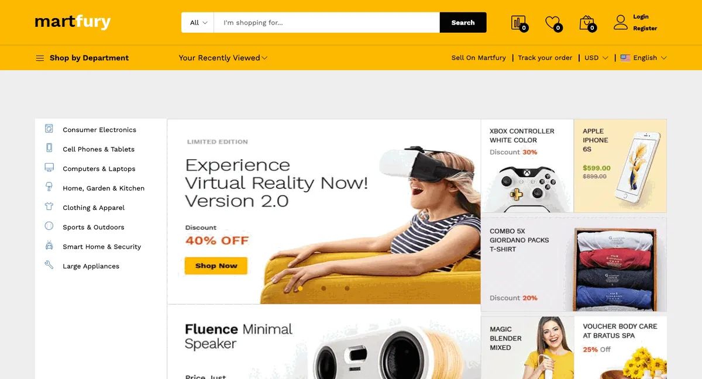

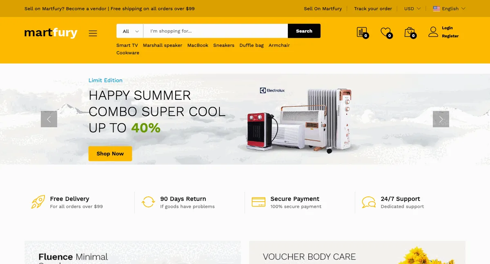

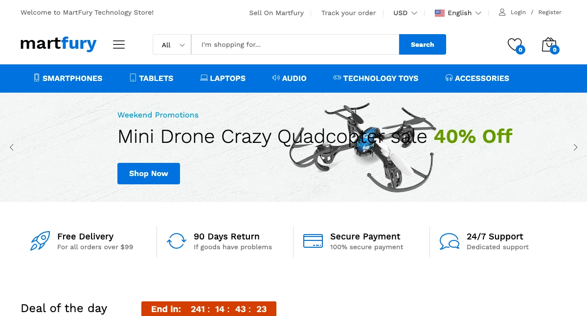

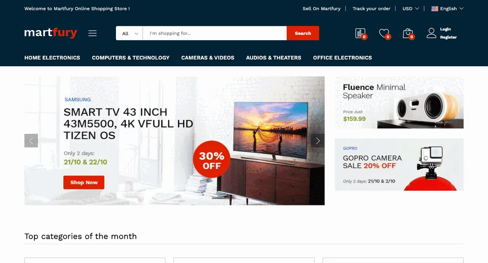

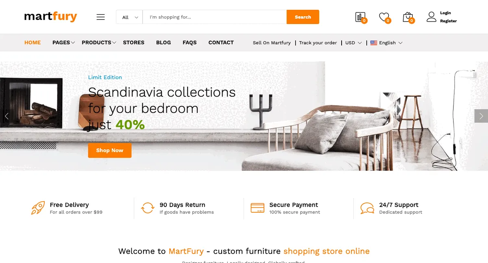

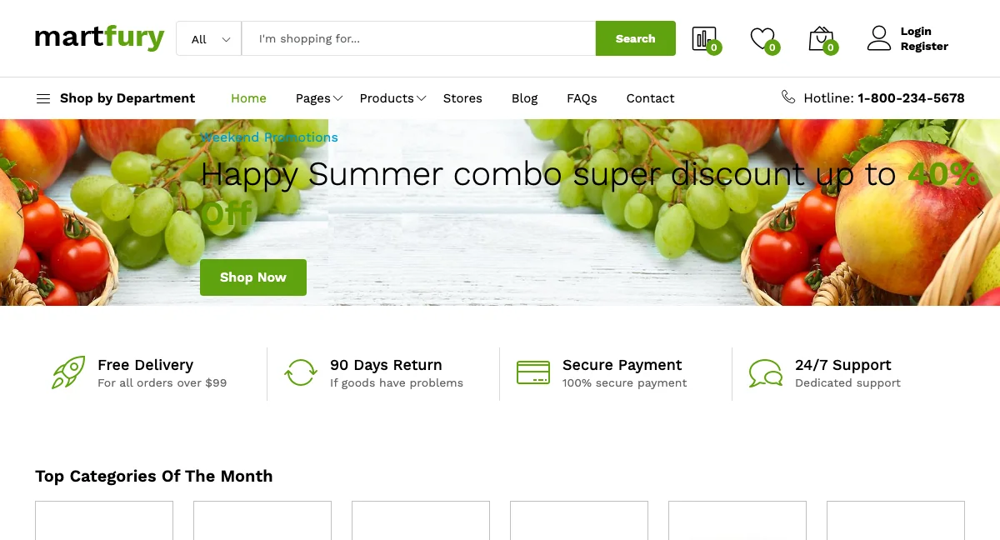

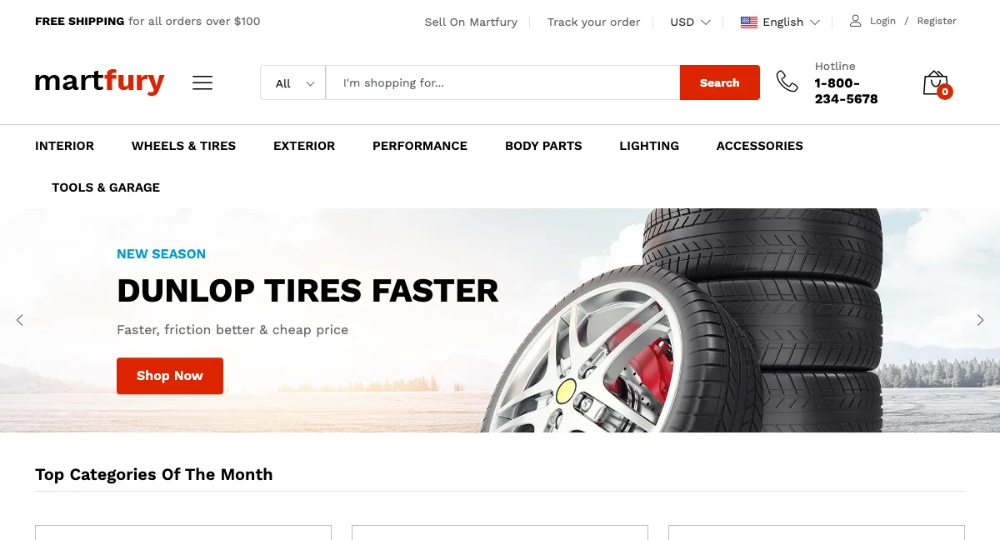

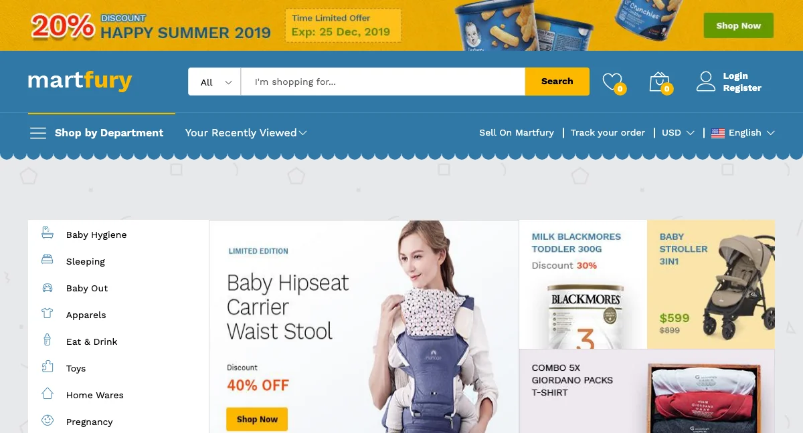

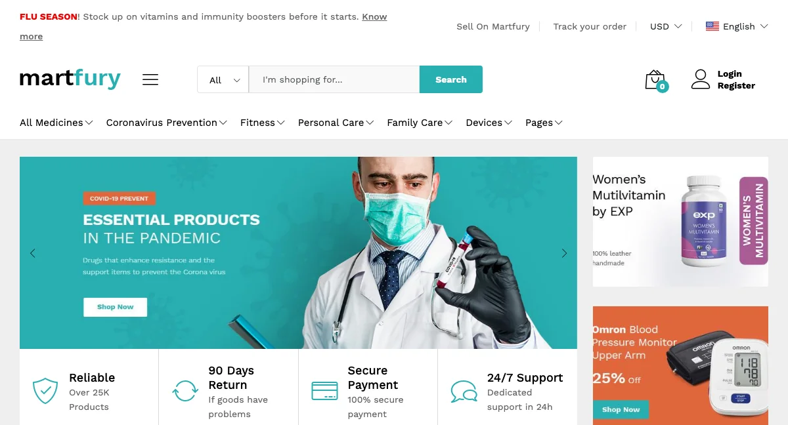

## Choose a Demo in the Installer

The demo is selected **during installation**, on the theme presets step of the [web installer](./installation-web-interface.md). The installer lists all 12 demos with a preview image. Its names differ from the table for three demos: Home 1 is listed as **Default**, Marketplace 1 as **Marketplace** and Auto parts as **Auto Parts**.

Each demo is a database dump. The installer imports `database/sample/database-martfury-<preset id>.sql` for the demo you pick (for example `database/sample/database-martfury-organic.sql`). The default demo uses `database.sql`. The `database/sample/` folder is part of the downloaded package, not of the source repository.

::: warning
Importing a demo replaces **all** existing content in the database, including the admin account. Use a fresh database or back up first.
:::

::: tip
Demo images are used for the demo only and are not part of the download. The demo content uses placeholder pictures, so replace them with your own products and banners before going live.
:::

## Switch the Look of an Existing Site

You can change the look of a site that is already installed without reimporting any data. Each demo uses its own footer colors and texts, and the header and footer settings of a demo are stored per preset, so switching the style alone does not copy them:

1. Go to `Appearance` -> `Theme options` -> `Colors and typography`. Set **Homepage style** to the demo's name (**Default** for Home 1) and **Primary color** to the demo's color (see [Primary color](./usage-theme-options.md#colors-and-typography)).
2. Go to `Header`. Set **Header style** to the demo's header style. Leave the header colors empty to use the colors of that style, or copy the header texts you want (**Header top text**, **Header search keywords**, promotion strip).
3. Go to `Footer`. Set **Footer style**, then set **Footer newsletter text**, **Footer social links text** and the footer colors. Footer colors do not follow the footer style, so set them to match the demo.
4. Save, then rebuild the homepage content with [UI blocks](./usage-ui-block.md).

If you work from the source code, the values of each demo are in `database/seeders/Themes/<Demo>/ThemeOptionSeeder.php`. See [Theme options](./usage-theme-options.md) for every field.

::: tip
The homepage sections of a demo are normal shortcodes inside the **Home** page. Open the page in the editor to see which blocks and styles the demo uses, then copy them to your own homepage.
:::

## Seed a Demo from the Command Line

If you work from the source code, you can seed a demo with Artisan instead of the installer. Run one of these commands on an empty database (after `php artisan migrate`):

| Demo | Command |
|------|---------|
| Home 1 (Multipurpose) | `php artisan db:seed` or `php artisan db:seed --class="Database\Seeders\Themes\Main\DatabaseSeeder"` |
| Marketplace 1 | `php artisan db:seed --class="Database\Seeders\Themes\HomeMarketplace\DatabaseSeeder"` |
| Marketplace 2 | `php artisan db:seed --class="Database\Seeders\Themes\HomeMarketplace2\DatabaseSeeder"` |
| Marketplace 3 | `php artisan db:seed --class="Database\Seeders\Themes\HomeMarketplace3\DatabaseSeeder"` |
| Marketplace 4 | `php artisan db:seed --class="Database\Seeders\Themes\HomeMarketplace4\DatabaseSeeder"` |
| Technology | `php artisan db:seed --class="Database\Seeders\Themes\HomeTechnology\DatabaseSeeder"` |
| Electronic | `php artisan db:seed --class="Database\Seeders\Themes\HomeElectronic\DatabaseSeeder"` |
| Furniture | `php artisan db:seed --class="Database\Seeders\Themes\HomeFurniture\DatabaseSeeder"` |
| Organic | `php artisan db:seed --class="Database\Seeders\Themes\HomeOrganic\DatabaseSeeder"` |
| Auto parts | `php artisan db:seed --class="Database\Seeders\Themes\HomeAutopart\DatabaseSeeder"` |
| Kids | `php artisan db:seed --class="Database\Seeders\Themes\HomeKids\DatabaseSeeder"` |
| Medical | `php artisan db:seed --class="Database\Seeders\Themes\HomeMedical\DatabaseSeeder"` |

::: danger
Seeding **wipes the existing data** (products, categories, pages, menus, settings and more) before it creates the demo content. Never run it on a live site. Seed presets one at a time, not in parallel.
:::

To drop all tables and seed a demo in one step, use `migrate:fresh` with the same class name (this is what the release packaging does):

```bash
php artisan migrate:fresh --seeder="Database\Seeders\Themes\HomeMarketplace\DatabaseSeeder"
```

### Seeder Namespace Change

Since version 1.42.0 the seeders of the default demo live in `database/seeders/Themes/Main` with the namespace `Database\Seeders\Themes\Main`. Before, they were in `database/seeders` with the namespace `Database\Seeders`.

This only matters if you customized the seeders:

- If you override a seeder (such as `ProductSeeder` or `PageSeeder`), move your copy to `database/seeders/Themes/Main` and update its namespace.
- If you call a seeder by class name, use `Database\Seeders\Themes\Main\DatabaseSeeder`. `php artisan db:seed` still runs the default demo.
- Sites that do not use the seeders are not affected.

## Create Your Own Homepage

1. Go to `Pages` and click `Create`.
2. Enter a **Name**, for example `Home`.
3. Add [UI blocks](./usage-ui-block.md) in the content editor.
4. Save, then go to `Appearance` -> `Theme options` -> `Page` and select the page in **Your homepage displays**.
