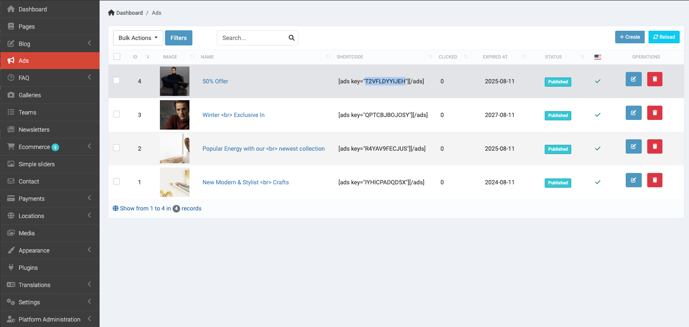

# Ads

::: tip
The ad images should NOT contain `ads`, `advert`... in the name. It may be blocked by Adblock extension.
:::

Google AdSense is also supported:

- **Auto Ads**: go to **Admin** -> **Ads** -> **Ads Settings**, set **Google AdSense Mode** to **Auto Ads** and paste the Auto Ads snippet.
- **Unit Ads**: set **Google AdSense Mode** to **Unit Ads** and enter your client ID, then create an ad with **Ads Type** = **Google AdSense** and enter its **Google AdSense Slot ID**.
