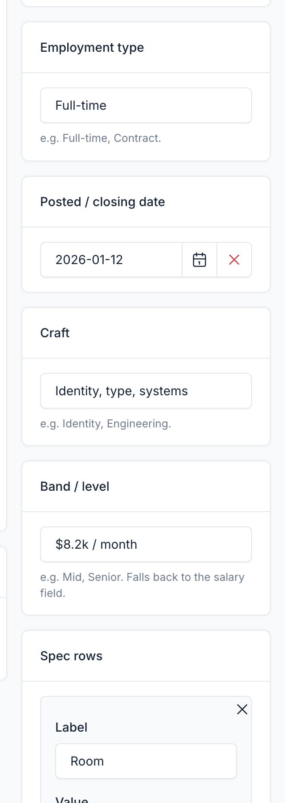
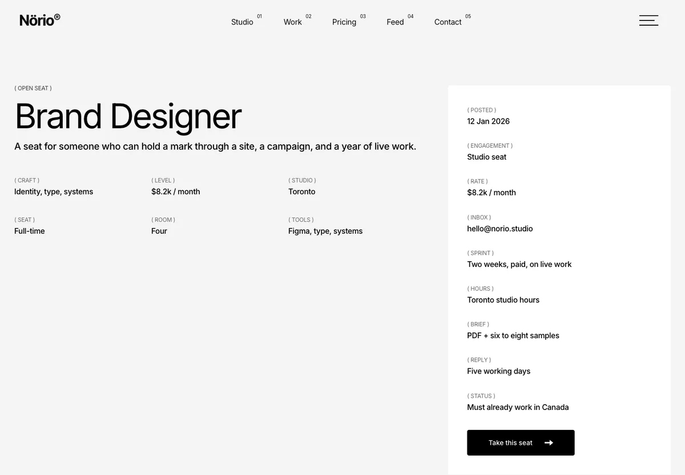
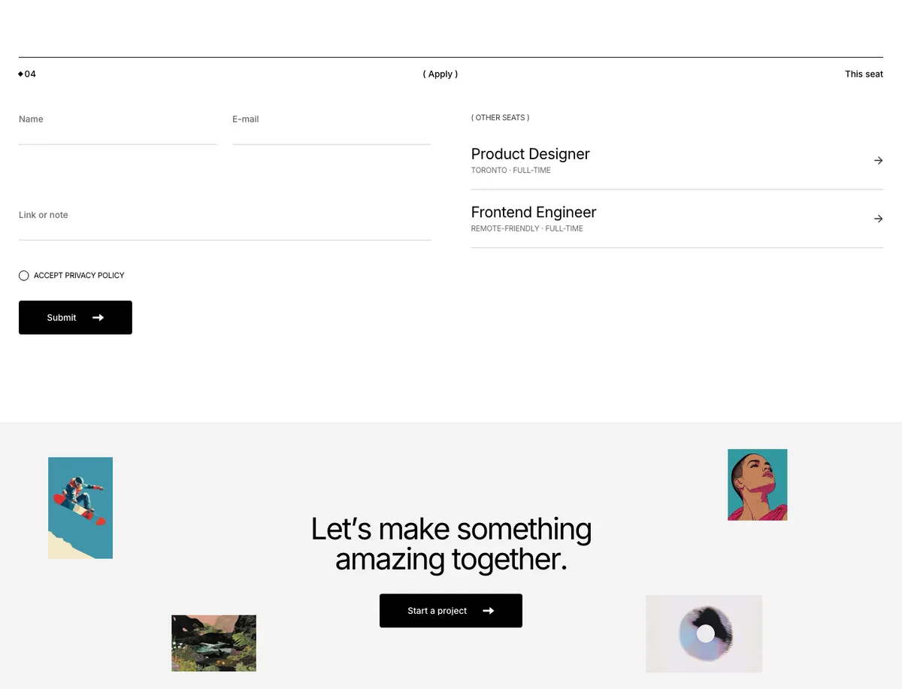

# Careers

The careers section lists open roles and lets candidates apply. Each role has its own page at `/careers/{slug}`, with an apply form and a list of other open roles.

Manage roles in `Admin` -> `Careers`.

## Core Fields

| Field | Purpose |
|-------|---------|
| **Name** | Job title |
| **Description** | Short summary shown in listings |
| **Location** | Where the role is based |
| **Salary** | Salary text, for example `Competitive`. Free text |
| **Content** | Full job description. Content blocks (shortcodes) can be placed here |
| **Status** | Publication status. Only published roles are listed |

## Theme Fields

| Field | Purpose |
|-------|---------|
| **Employment type** | For example `Full-time`. Shown in the role overview |
| **Posted / closing date** | Date shown as "Posted" in the role overview |
| **Craft** | Discipline, for example `Design` or `Engineering`. Shown in the role overview grid |
| **Band / level** | Seniority, for example `Senior` |
| **Spec rows** | Extra label and value pairs for the overview. The first ones fill the grid, the rest go in the side column |

## Apply Form

The role page includes the **Contact form** block in style 4, which works as the application form. Applications are sent through the Contact plugin. Check them under the contact list in the admin panel. Style 4 also lists the other open roles.

::: tip
Make sure the Contact plugin is active and its form is set up before you publish roles. Otherwise the apply form will not appear or will not send.
:::

## Careers Listing

Open roles are listed at `/careers`. Use the **Careers** UI block to show a list on any page. See [UI Blocks](./usage-ui-block.md).
