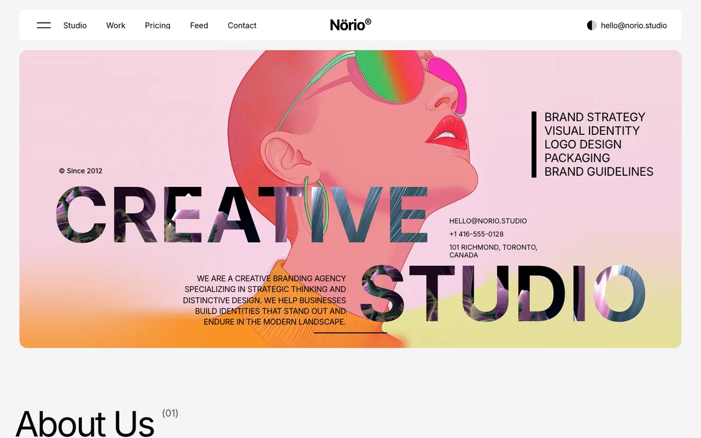
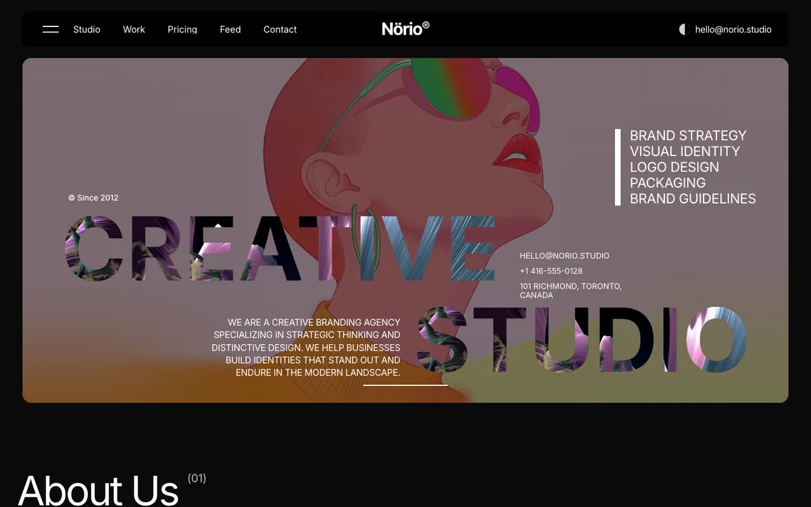
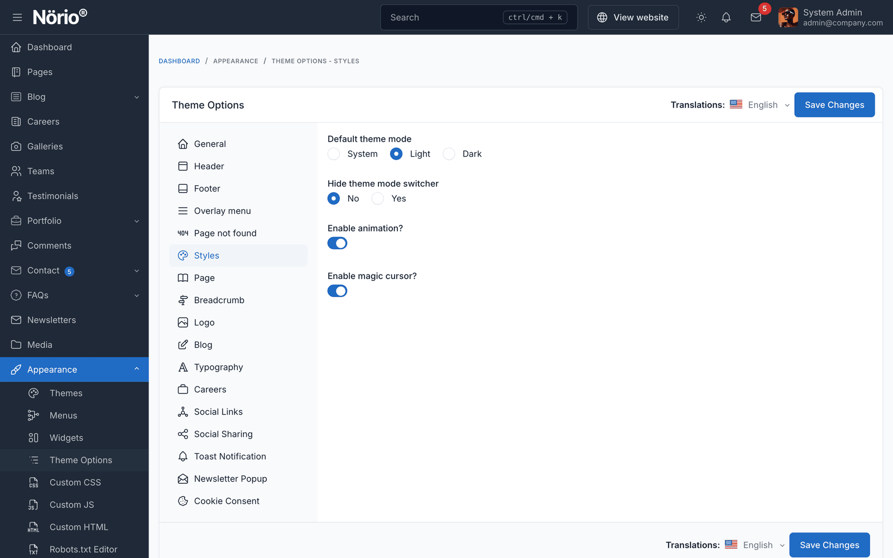

# Dark Mode

Norio supports a light and a dark colour scheme. You choose the default for visitors in Theme Options, and visitors can switch between the two themselves.

## Default Theme Mode

Go to `Appearance` -> `Theme Options` -> `Styles` -> **Default theme mode**.

| Option | Behaviour |
|--------|-----------|
| **Light** (default) | New visitors see the light scheme |
| **Dark** | New visitors see the dark scheme |
| **System** | New visitors follow their operating system setting (light or dark) |

## Which Scheme a Visitor Sees

The scheme is decided in this order:

1. The scheme the visitor picked with the switcher. It is saved in the browser, so it applies on later visits from the same browser.
2. The **Default theme mode**. With **System**, the operating system setting is used.

::: tip
Changing the default mode does not reset choices visitors have already made. Visitors who picked a scheme keep it.
:::

## Visitor Switcher

The light and dark switcher appears in:

- Header style 2 (next to the email)
- Header style 3 (on the right, with the overlay toggle)
- Footer style 1
- The overlay menu

To hide the switcher everywhere, set **Hide theme mode switcher** to **Yes** in `Appearance` -> `Theme Options` -> `Styles`. Use this when your default mode is fixed for the brand.

## Logos in Dark Mode

Logos switch with the scheme:

| Logo | Where | Setting |
|------|-------|---------|
| Main logo | Header in light mode | Theme Options -> Logo |
| **Dark mode logo** | Header in dark mode | Theme Options -> Logo -> Dark mode logo |
| Footer wordmark | Footer style 1 in light mode | Theme Options -> Footer -> Footer logo wordmark (light mode) |
| Footer wordmark (dark) | Footer style 1 in dark mode | Theme Options -> Footer -> Footer logo wordmark (dark mode) |

If a dark mode logo is not set, the theme uses a bundled white mark. Upload a light-coloured logo for a dark background. See [Logo customization](./usage-logo-customization.md).

## Colours

Norio has no colour pickers in Theme Options. The light and dark palettes are part of the theme. To change them, use [Custom CSS/JS](./usage-custom-css-js.md) with care, and test both schemes after each change.
