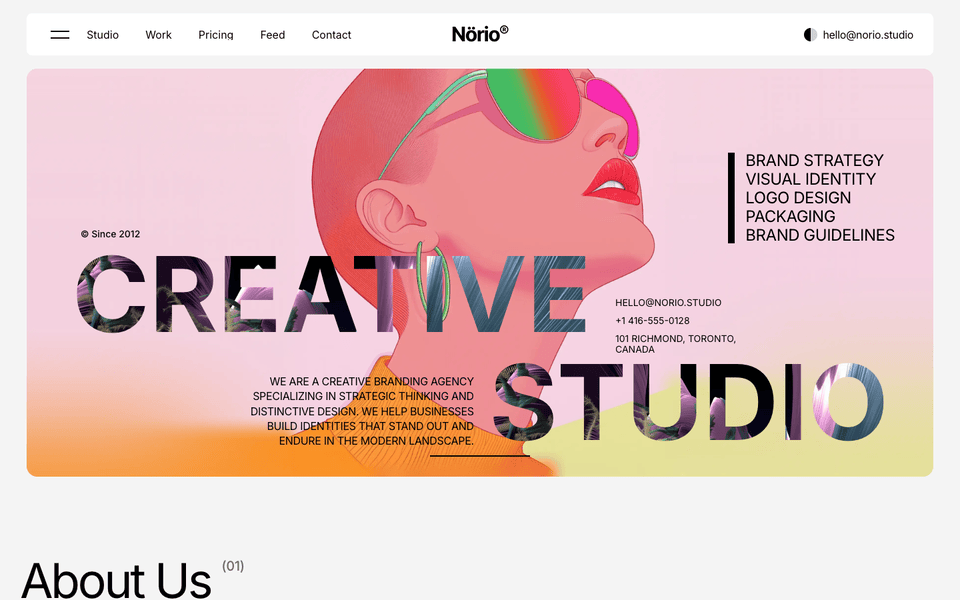
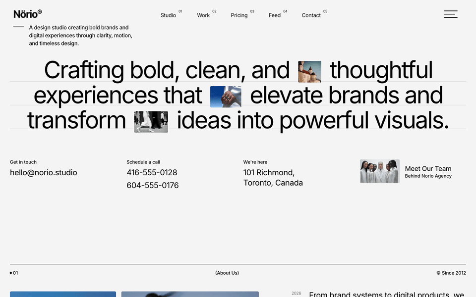
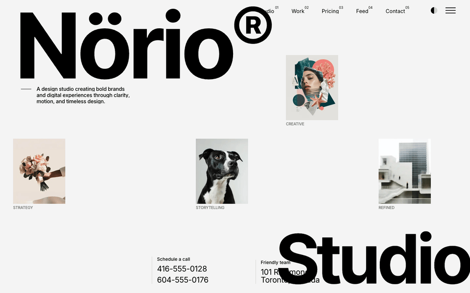
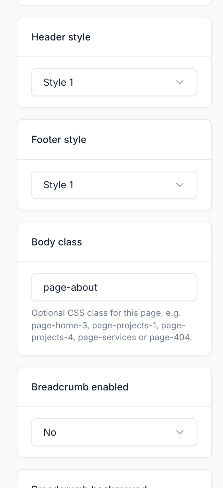
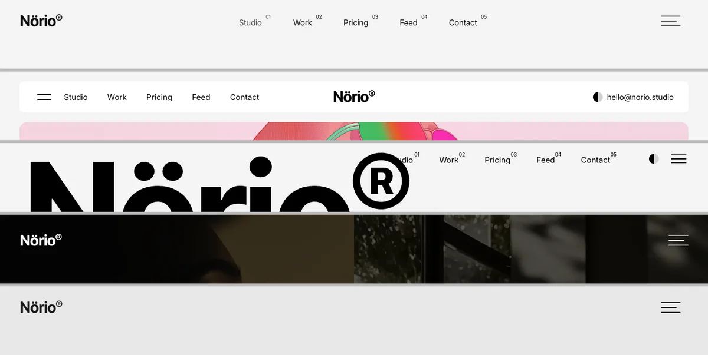
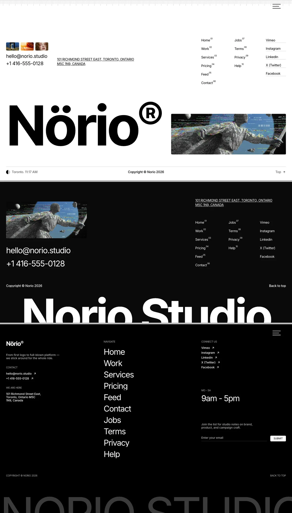

# Homepage

The homepage is the first page visitors see. In Norio it is a normal CMS page built from UI blocks, using the **Homepage** page template.

## Homepage Presets

Norio ships with **3 homepage presets**. You choose one during installation. Each preset is a complete demo: pages, menus, theme options and content.

| Preset | Homepage sections (top to bottom) | Header | Footer | Demo |
|--------|-----------------------------------|--------|--------|------|
| **Creative Studio** | Hero, about, image gallery, projects, services, partners, features, pricing, keyword ticker, testimonials, blog, call to action | Style 2 (page override) | Style 2 (page override) | <https://norio.botble.com> |
| **Modern Agency** | Hero, about, projects, services, testimonials, process, pricing, awards, FAQs, blog | Style 1 (theme option) | Style 1 (theme option) | <https://norio-home-2.botble.com> |
| **Digital Startup** | Hero, services, projects, testimonials, features, call to action, pricing, FAQs, contact form | Style 3 (theme option and page) | Style 3 (theme option and page) | <https://norio-home-3.botble.com> |

### Choosing a Preset

The preset is selected **during installation**, on the theme presets step of the web installer. There is no preset importer in the admin panel.

Each preset is a full database dump. The installer looks for the matching file in this order:

1. `database-norio-creative-studio.sql` (Creative Studio), `database-norio-modern-agency.sql` (Modern Agency) or `database-norio-digital-startup.sql` (Digital Startup) at the project root.
2. The same file name inside `database/sample/`.
3. `database/sample/database.sql`, then `database.sql`.

::: warning
A database dump replaces **all** existing content, including the admin account. Use a fresh database or back up first.
:::

### Switching to a Different Preset

If the site is already installed and you want a different preset, you have two options.

**Re-run the installer:**

1. Drop all tables in your database.
2. Delete the file `storage/installed`.
3. Reload your site to start the installer again and pick the preset you want.

**Import the SQL file directly:**

1. Drop all tables in your database.
2. Import the matching file via phpMyAdmin or the `mysql` command line.
3. Confirm `APP_URL` and the database credentials in `.env` are correct.

## Create a Homepage

If you start from a preset, the homepage already exists. To build your own:

1. Go to `Pages` and click `Create`.
2. Enter a **Name**, for example `Home`.
3. Choose the **Template** `Homepage`.
4. Add UI blocks in the content editor. See [UI Blocks](./usage-ui-block.md).
5. Save, then set it as the homepage (next section).

## Set the Homepage

In the admin panel, go to `Appearance` -> `Theme Options` -> `Page`, and select the page in **Your homepage displays**.

## Page Meta Fields

Each page has these theme fields in the page editor. They apply only to that page.

| Field | Options | Purpose |
|-------|---------|---------|
| **Header style** | Use the theme option, Style 1 to Style 5 | Overrides the site-wide header for this page |
| **Footer style** | Use the theme option, Style 1 to Style 3 | Overrides the site-wide footer for this page |
| **Body class** | Free text | Adds a CSS class to the `<body>` tag. Some Norio styles depend on it, for example `page-home-3`, `page-projects-1`, `page-projects-4`, `page-services` and `page-404`. Only letters, digits, `-`, `_` and spaces are kept |

::: tip
Set the **Body class** when you rebuild one of the demo homepages. The Digital Startup layout depends on `page-home-3`, and the Projects layouts depend on the `page-projects-*` classes.
:::

### Header Styles

| Style | Used for |
|-------|----------|
| 1 | Logo and numbered navigation on one row, overlay toggle at the end. Index and inner pages |
| 2 | Overlay toggle and primary navigation on the left, logo centred, colour toggle and email on the right |
| 3 | Numbered navigation on the left, colour toggle and overlay toggle on the right. No logo |
| 4 | White logo and overlay toggle over a dark showcase. Projects layout 1 |
| 5 | Logo and overlay toggle, no navigation. Projects layout 2 |

### Footer Styles

| Style | Used for |
|-------|----------|
| 1 | Thumbnails and contact, numbered footer menus, social links, wordmark with a lazy video, live clock. Most pages |
| 2 | Feature picture and contact links, address, numbered footer menus and a large wordmark |
| 3 | Brand column with contact and address, navigate list, opening hours, newsletter form and a large wordmark |

The footer links come from the `footer-menu` and `footer-secondary-menu` locations. See [Menu](./usage-menus.md).

## Customize the Homepage

Any page can be customized with UI blocks. The list of available shortcodes is in [UI Blocks](./usage-ui-block.md).
