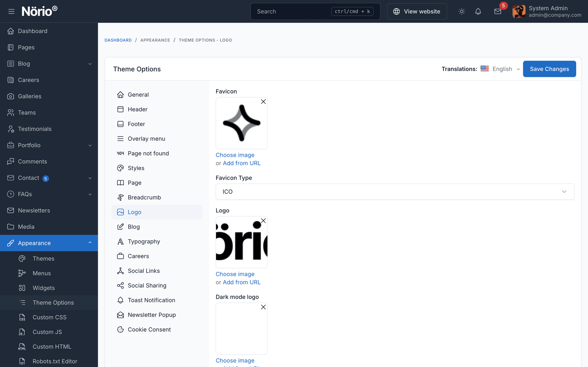
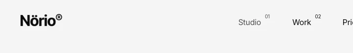

# Logo Customization

Norio lets you set the logo, the dark mode logo, the favicon and the logo size from the admin panel. No custom CSS is needed.

## Logo Fields

All logo fields are in `Appearance` -> `Theme Options` -> `Logo`.

| Field | What it is used for |
|-------|---------------------|
| **Logo** | Main logo in the header, in light mode |
| **Dark mode logo** | Light-coloured logo shown in the header in dark mode. Falls back to the bundled white mark if empty |
| **Favicon** | Browser tab icon |
| **Favicon type** | Core favicon option. Choose it from the list in the field |

::: tip
The theme does not invert colours. Recolour a logo to white, or near-white, in your image editor before you upload it as the dark mode logo.
:::

## Logo Size Controls

The size fields are in the same **Logo** section. Leave a field empty to use the theme default.

| Field | What it controls |
|-------|------------------|
| **Logo height on desktop (px)** | Height for screens 1200 px and wider |
| **Logo height on tablet (px)** | Height for screens from 768 to 1199 px. Inherits the desktop value if empty |
| **Logo height on mobile (px)** | Height for screens under 768 px. Inherits the tablet, then desktop value if empty |
| **Logo max width (px)** | Caps the width. Useful for very wide horizontal logos |

### Starting Points

These values are a starting point. Adjust them to your logo.

| Logo shape | Desktop | Tablet | Mobile | Max width |
|------------|---------|--------|--------|-----------|
| Horizontal wordmark | 50 to 70 px | 40 to 50 px | 32 to 40 px | 200 to 240 px |
| Square or icon only | 40 to 48 px | 36 to 42 px | 32 to 36 px | Empty |

## Remove Old Logo CSS

If you sized the logo before with a hand-written rule in `Appearance` -> `Custom CSS`, remove that rule. A leftover rule can override the sizes you set in the fields above.

## After Saving

Clear the cache and hard-refresh the browser:

1. Go to `Admin` -> `Platform Administration` -> `Cache Management` and click **Clear all caches**.
2. Press `Ctrl+Shift+R` (Windows and Linux) or `Cmd+Shift+R` (macOS).
