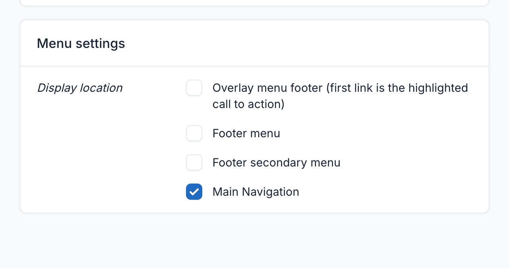
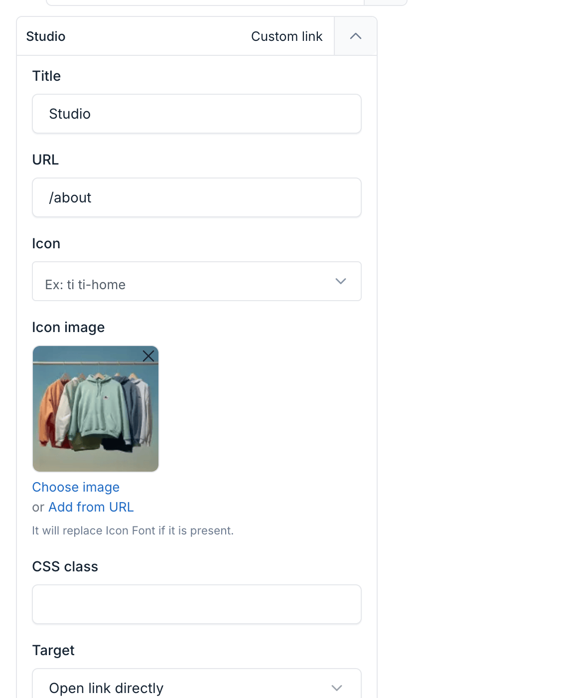
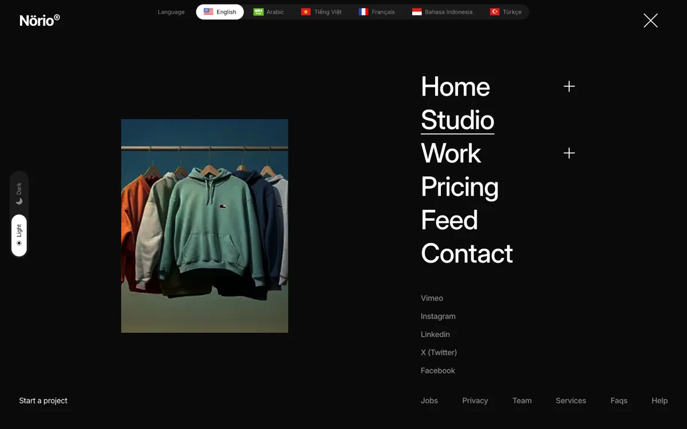

# Menu

Menus control the navigation of your site. Norio has four menu locations. They drive the header, the full-screen overlay menu, the bottom navigation and the footer.

You manage menus from `Appearance` -> `Menus` in the admin panel.

## Menu Locations

| Location | Feeds | Notes |
|----------|-------|-------|
| **Main Navigation** (`main-menu`) | Header navigation, overlay menu, bottom navigation | Primary menu of the site |
| **Overlay menu footer** (`overlay-footer-menu`) | Footer of the overlay menu | The **first link** is shown as the highlighted call to action |
| **Footer menu** (`footer-menu`) | Footer link list | Numbered automatically in footer styles 1 and 2 |
| **Footer secondary menu** (`footer-secondary-menu`) | Second footer link list | In footer styles 1 and 2, numbering continues from the footer menu. Footer style 3 merges both menus into one "Navigate" list |

To assign a menu to a location, enable the matching checkbox in the **Display location** section of the menu edit page.

::: tip
Each location appears once. Build one menu per location, then tick the location. A menu can use more than one location if you need the same links in two places.
:::

## Adding Menu Items

1. Click `Create`, enter a name and save.
2. In the menu edit page, pick items from the left side and click `Add to menu`.
3. Drag items to reorder them, or drop them under another item to create a sub-menu.

Available item types: custom links, pages, post categories and post tags.

## Overlay Menu Preview Images

The overlay menu shows a preview image beside the links. It changes as the visitor hovers over a link.

- **Per link**: open a menu item and upload an **Icon image**. Use it for the main navigation links.
- **Child links** use their parent's image when they have none.
- **Default**: when no link is hovered, and for links without an image, the image set in `Appearance` -> `Theme Options` -> `Overlay menu` -> **Default preview image** is used.

::: tip
Use images with the same aspect ratio for every link. Mismatched sizes make the preview jump as the visitor moves between links.
:::

## Hide a Link from the Header

Add the CSS class `overlay-only` to a menu item (field **CSS class** in the item editor). Items with this class appear only in the overlay menu. They are hidden from the header and the bottom navigation.

Use it for links that belong in the overlay but would clutter the header, for example a long list of homepage variants.

## Header Toggle

Every header style has an overlay toggle that opens the overlay menu. See [Homepage](./usage-homepage.md#header-styles) for the list of header styles.
