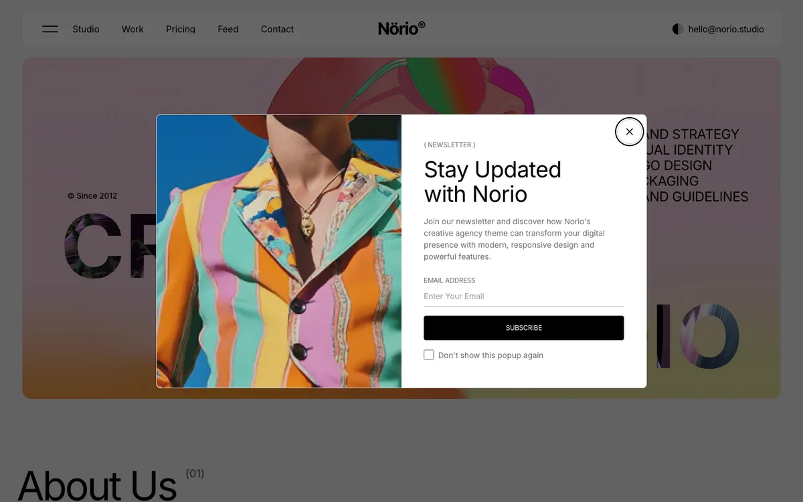

# Newsletter Popup

The newsletter popup is the window that asks first-time visitors to subscribe to your mailing list. You set its content, images and timing from the admin panel.

::: tip
The newsletter popup is **on** in the demo data: it opens on the homepage after about 8 seconds. Turn off **Enable newsletter popup** if you do not want it. Test it in a private window before you publish.
:::

## Where to Edit

Go to `Appearance` -> `Theme Options` -> `Newsletter popup`.

## Fields

| Field | Purpose |
|-------|---------|
| **Enable newsletter popup** | Master switch. Turn it off to hide the popup site-wide |
| **Popup image** | Image for desktop screens |
| **Popup tablet image** | Image for tablet screens |
| **Popup mobile image** | Image for mobile screens |
| **Title** | Main heading above the form, for example `Stay in the loop` |
| **Subtitle** | Short label above the title, for example `Newsletter` |
| **Description** | Text between the title and the email field. Explain what subscribers receive |
| **Popup delay (seconds)** | Time to wait after the page loads before the popup opens. Default: `5` |
| **Display on pages** | **Homepage** (default) or **All pages** |

## Show Once Per Visitor

The popup is controlled by a cookie. After a visitor closes it, the popup does not open again in that browser. To see it again while you test, use a private or incognito window, or clear the cookie.

## Where Subscribers Go

Submissions go to your newsletter provider. Set it up as described in [Newsletter](./usage-newsletter.md). Without a provider, subscribers are saved in the **Newsletter subscribers** list in the admin panel.

## After Saving

Clear the cache:

1. Go to `Admin` -> `Platform Administration` -> `Cache Management` and click **Clear all caches**.
2. Open your site in a private or incognito window to check the popup.

For the newsletter sign-up section and provider setup, see [Newsletter](./usage-newsletter.md).
