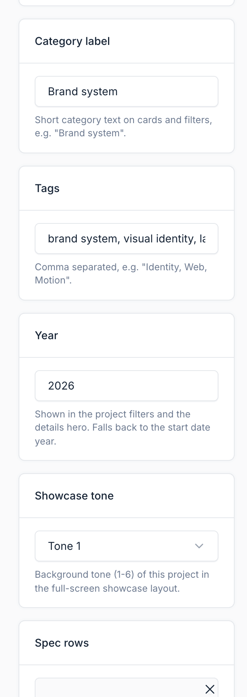
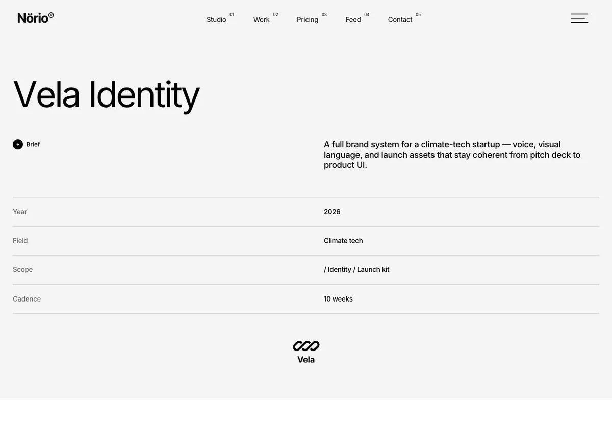
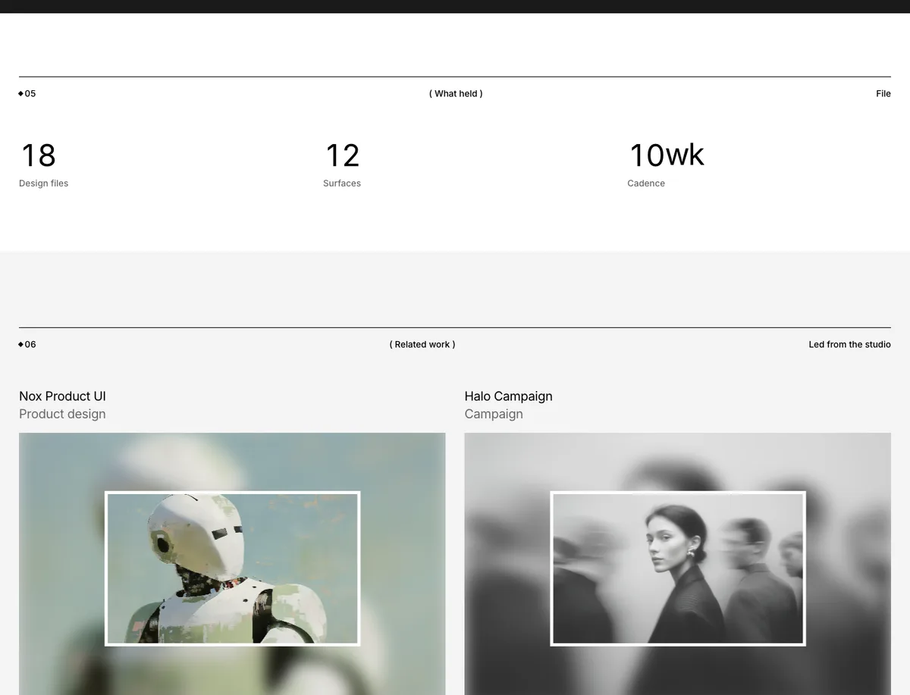
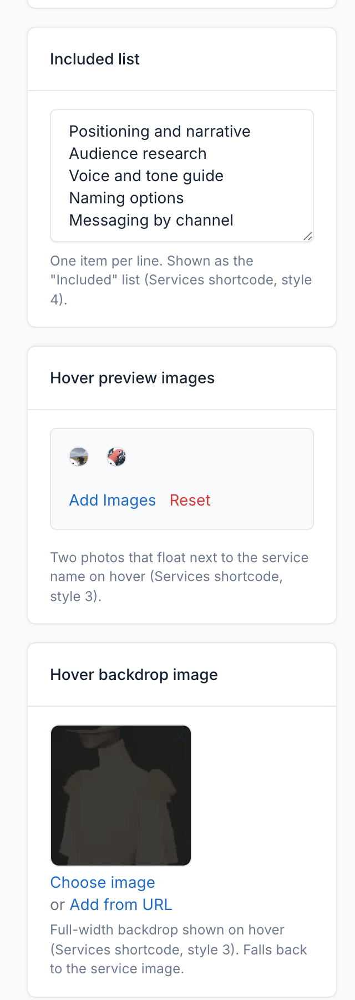

# Portfolio (Projects and Services)

Projects and services are the core of a Norio portfolio. Projects show your work. Services describe what you offer. Both come from the Portfolio plugin and have extra theme fields for the design.

## Projects

Manage projects in `Admin` -> `Portfolio` -> `Projects`.

### Core Fields

| Field | Purpose |
|-------|---------|
| **Name** | Project title |
| **Description** | Short summary used on cards |
| **Content** | Full case study. Content blocks (shortcodes) can be placed here |
| **Image** | Featured image |
| **Author** | Name stored with the project |
| **Client**, **Place** | Shown as meta on cards and in the project hero |
| **Start date** | Used for the year when **Year** is empty |
| **Order**, **Is featured**, **Status** | Sorting, featured flag and publication |
| **Metric 1 to 3 (value and label)** | Outcome figures, see below |

### Theme Fields

| Field | Purpose |
|-------|---------|
| **Project link (Live Demo)** | External URL. When set, a **Live Demo** row with the link shows in the project details. Only `http` and `https` links are accepted |
| **Category label** | Short category text on cards and filters, for example `Brand system` |
| **Tags** | Comma-separated tags, for example `Identity, Web, Motion` |
| **Year** | Shown in filters and the detail hero. Falls back to the start date year |
| **Showcase tone** | Background tone (1 to 6) for the full-screen showcase layout |
| **Spec rows** | Label and value pairs under the title, for example `Year / 2026`. When empty, the year, client and place are used |
| **Client quotes** | Testimonials shown in the quote slider. Requires the Testimonial plugin |
| **Gallery images** | Extra images shown as lightbox plates on the project page. The featured image is always shown first |

### Outcome Metrics

Fill **Metric 1 to 3** with a value and a label, for example `24wk` and `Delivery time`. The project page shows them in the Outcome section. A value such as `24wk` is split into a number and a suffix, so the number can animate.

Leave both fields of a metric empty to hide it.

### Project Pages

Each project has a detail page at `/projects/{slug}`. Use the **Projects** UI block to list them on any page. See [UI Blocks](./usage-ui-block.md#projects-styles) for the eight layouts.

## Services

Manage services in `Admin` -> `Portfolio` -> `Services`.

### Core Fields

| Field | Purpose |
|-------|---------|
| **Category** | Service category. Its name is used as the service label |
| **Name**, **Description**, **Content** | Service title, summary and full text |
| **Image** | Service image |
| **Order**, **Is featured**, **Status** | Sorting, featured flag and publication |

### Theme Fields

| Field | Purpose |
|-------|---------|
| **Service items** | Items for the Services UI block, style 2 |
| **Tags** | Comma-separated tags for the service |
| **Included list** | One item per line. Shown as the "Included" list |
| **Hover preview images** | Two images shown when a service is hovered in the list |
| **Hover backdrop image** | Background image for the hover preview |
| **Card button label** | Button text on the service card |
| **Spec rows** | Label and value pairs for the service page hero. The first six fill the grid, the rest go in the side card |

Service detail pages are at `/services/{slug}`. Service categories are at `/service-categories/{slug}`.

::: tip
Use the **Services** UI block to list services on any page. Style 4 shows the category name as the label.
:::
