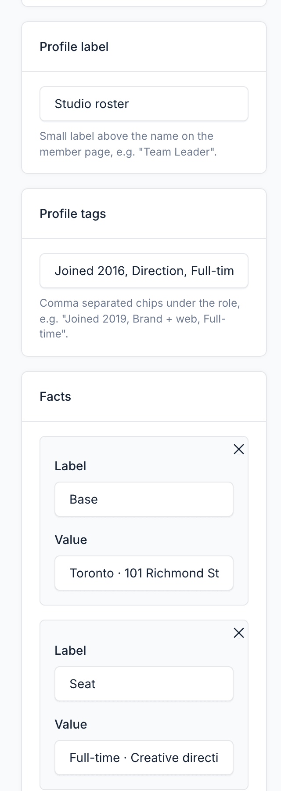
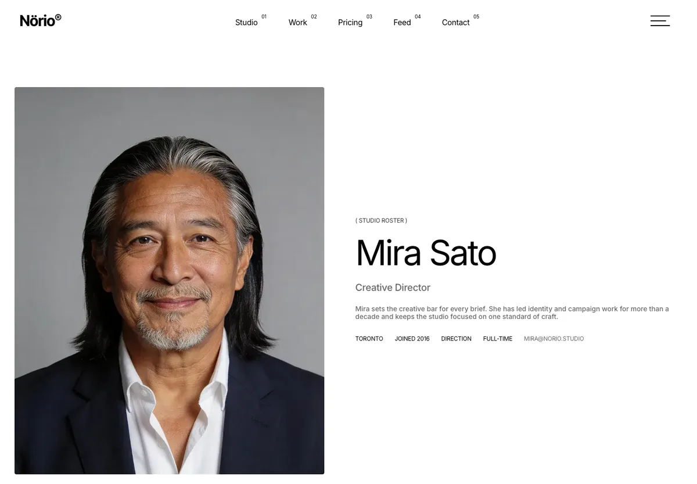
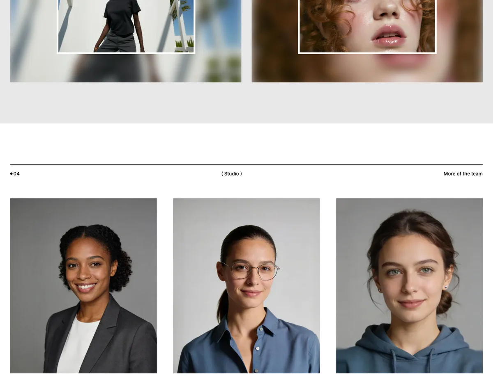

# Team

Team pages present the people behind your studio. Each member has a profile page at `/teams/{slug}`, and the Teams UI block lists members anywhere on the site.

Manage members in `Admin` -> `Teams`.

## Core Fields

| Field | Purpose |
|-------|---------|
| **Name** | Member name |
| **Title** | Role, shown under the name |
| **Description** | Short bio used on cards |
| **Content** | Full profile text. Content blocks (shortcodes) can be placed here |
| **Photo** | Profile photo |
| **Email**, **Phone**, **Address**, **Website**, **Location** | Contact details. Used by the member page |
| **Facebook**, **Twitter**, **Instagram** | Social profile links |
| **Status** | Publication status |

## Theme Fields

| Field | Purpose |
|-------|---------|
| **Profile label** | Small label above the name on the member page, for example `Team Leader` |
| **Profile tags** | Comma-separated chips under the role, for example `Joined 2019, Brand + web` |
| **Icon: Facebook / Twitter / Instagram** | Icon for each social link. Defaults to the matching brand icon |
| **Facts** | Up to four label and value pairs on the member page, for example `Base / Toronto`. When empty, the address, email and phone are used |

## Member Pages

Each member page shows the profile hero, the content, and three other team members under **More of the team**. The **Team Details Sidebar** widget area appears at the bottom of the page. See [Widgets](./usage-widgets.md).

## Team Block

Use the **Teams** UI block to list members on any page. It has three styles. See [UI Blocks](./usage-ui-block.md).
