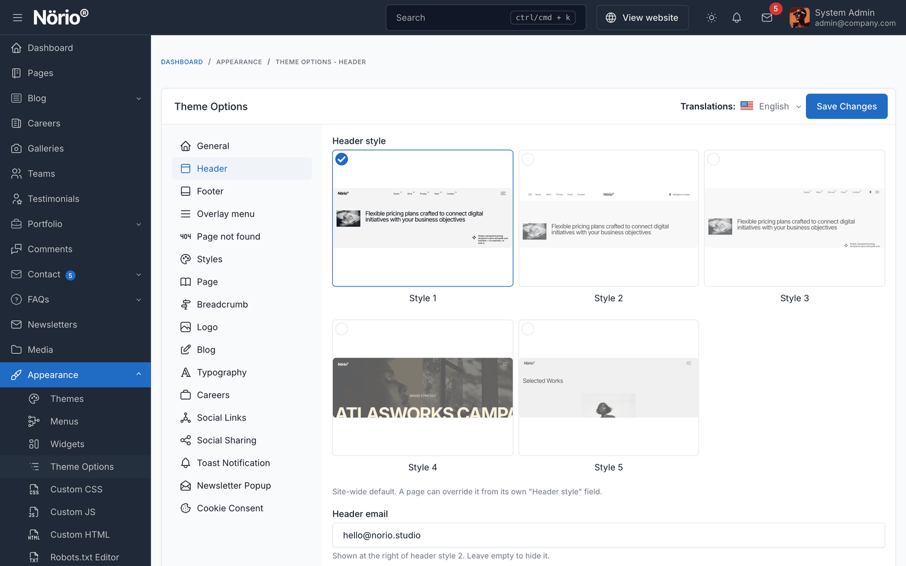

# Theme Options

Theme options control the look and behaviour of the whole site: header and footer styles, footer content, dark mode, the overlay menu, the 404 page and the blog. You can change them without touching code.

Go to `Appearance` -> `Theme Options` in the admin panel.

## Pages

| Field | Purpose |
|-------|---------|
| **Your homepage displays** | Select the page that serves as the homepage |

## Header

| Field | Purpose |
|-------|---------|
| **Header style** | Site-wide header, Style 1 to Style 5. A page can override it in its own **Header style** field |
| **Header email** | Shown at the right of header style 2. Leave empty to hide it |

## Footer

| Field | Purpose |
|-------|---------|
| **Footer style** | Site-wide footer, Style 1 to Style 3. A page can override it |
| **Footer wordmark** | Large text at the bottom of footer styles 2 and 3. Default: `Norio Studio` |
| **Footer tagline** | Text used by footer style 3 |
| **Footer email**, **Footer phone** | Contact details in the footer |
| **Footer address** | Plain text, one line per row |
| **Footer address link** | Map URL opened from the address, for example a Google Maps link |
| **Footer clock time zone** | IANA time zone for the live clock in footer style 1. Default: `America/Toronto` |
| **Footer clock label** | City name printed before the clock in footer style 1. Default: `Toronto.` |
| **Opening days**, **Opening hours** | Shown in footer style 3, for example `Mo - Sa` and `9am - 5pm` |
| **Newsletter text** | Short invitation above the newsletter form in footer style 3 |
| **Footer image** | Picture for footer style 2, and the poster of the footer style 1 video |
| **Footer video** | MP4 or WebM loop for footer style 1. It loads when the footer comes into view |
| **Footer logo wordmark (light mode)** and **(dark mode)** | Large wordmark of footer style 1. Falls back to the bundled Norio wordmark |
| **Footer thumbnail 1 to 3** | Thumbnails in footer style 1 |

::: tip
The footer links come from the **Footer menu** and **Footer secondary menu** locations. Edit them in `Appearance` -> `Menus`. See [Menu](./usage-menus.md).
:::

## Overlay Menu

| Field | Purpose |
|-------|---------|
| **Default preview image** | Shown beside the overlay menu when no link is hovered, and for links without their own image |
| **Hide language switcher in header** | Hides the language list shown at the top of the overlay menu. Off by default; the list only appears when the Language plugin is active with more than one language. See [Multi-language](./usage-multi-language.md#language-switcher) |

## Page Not Found (404)

| Field | Purpose |
|-------|---------|
| **404 title**, **404 description** | Text of the 404 page hero |
| **404 images** | Pictures used by the 404 hero |
| **404 path cards** | Cards that lead visitors back into the site, each with a title, description and URL. Leave empty for the default Home, Blog and Search cards |

## Styles

| Field | Options | Default | Purpose |
|-------|---------|---------|---------|
| **Default theme mode** | System, Light, Dark | Light | Colour scheme for first-time visitors. See [Dark mode](./usage-dark-mode.md) |
| **Hide theme mode switcher** | No, Yes | No | Hides the light and dark switcher wherever it appears: header styles 2 and 3, footer style 1 and the overlay menu |
| **Enable smooth scrolling** | On, Off | On | Inertia scrolling on desktop. Turn off for native browser scrolling. Always off for visitors who prefer reduced motion |
| **Enable custom cursor** | On, Off | On | Animated cursor and magnetic buttons on desktop |
| **Enable mouse-follow effects** | On, Off | On | Images and cards that tilt or move with the pointer. Sliders and galleries keep working |

## General

| Field | Purpose |
|-------|---------|
| **Preloader image** | Image shown on the loading screen |
| **Preloader image width** | Width in pixels. Default: `87` |

The preloader itself is turned on or off with the core preloader toggle.

## Logo

| Field | Purpose |
|-------|---------|
| **Logo** | Main logo in light mode (core field) |
| **Favicon**, **Favicon type** | Browser icon (core fields) |
| **Dark mode logo** | Light-coloured logo shown in the header in dark mode. Falls back to the bundled white mark |
| **Logo height on desktop / tablet / mobile (px)** | Height for each screen size. Leave empty to inherit |
| **Logo max width (px)** | Caps the logo width. Leave empty for no cap |

For sizing advice and the cache step after saving, see [Logo customization](./usage-logo-customization.md).

## Blog

| Field | Purpose |
|-------|---------|
| **Blog hero title** | Heading of the blog archive hero. Leave empty to use the blog page name |
| **Blog hero stats** | One stat per line as `value\|label`, for example `1025+\|Premium Posts`. Leave empty to show the live post and author counts |
| **Post title heading level on archive pages** | Semantic heading level for post titles in archives. H2 by default |
| **Show featured posts on blog page** | When on, the first 3 posts appear as a featured hero. Turn off to show all posts in one grid |

## Typography

Norio uses **Inter** for body and headings. The sizes are set in pixels for each level.

| Level | Default |
|-------|---------|
| Heading 1 | 60 px |
| Heading 2 | 48 px |
| Heading 3 | 38 px |
| Heading 4 | 31 px |
| Heading 5 | 25 px |
| Heading 6 | 20 px |
| Body | 16 px |

## Social Links and Other Core Sections

Theme options also include the core sections **Social Links**, **Social Sharing** and **Toast Notification**. The social profiles added under **Social Links** are shown in the footer.

## Newsletter Popup

The newsletter popup settings are in their own section. See [Newsletter popup](./usage-newsletter-popup.md).
