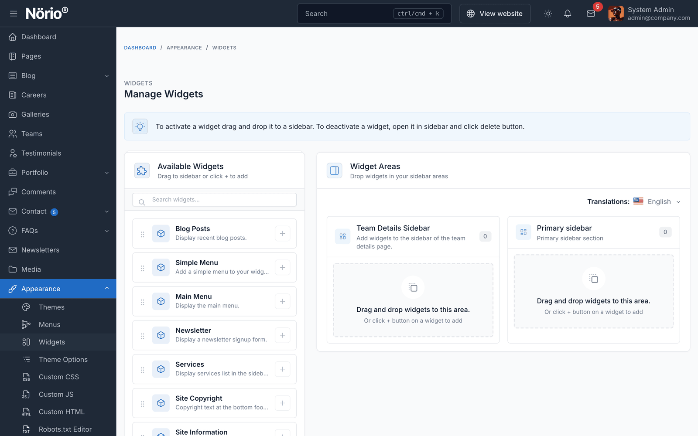

# Widgets

Widgets place small blocks of content into widget areas. In Norio, the header and footer are driven by menus and theme options, so widgets are used for the Team Details sidebar and any extra blocks you add.

## Manage Widgets

Go to `Appearance` -> `Widgets` in the admin panel.

To add a widget to an area, drag it from the left panel to the area on the right. To remove one, open it and click **Delete**.

## Available Widgets

| Widget | Description |
|--------|-------------|
| **Site Logo** | Displays the site logo |
| **Main Menu** | Displays the main navigation menu |
| **Site Information** | Displays company information |
| **Services** | Services list pulled from the Portfolio plugin |
| **Blog Posts** | Recent blog posts |
| **Newsletter** | Newsletter sign-up form |
| **Core Simple Menu** | Simple link list from a menu |
| **Site Copyright** | Copyright text |

## Widget Areas

On the front end of this release, one widget area is displayed:

| Area | Where it appears |
|------|------------------|
| **Team Details Sidebar** | Below the content of each team member page |

::: warning
The admin panel also lists the Blog top, Service Details and Project Details sidebars. This release does not display them, so widgets placed there will not show on the site.
:::
