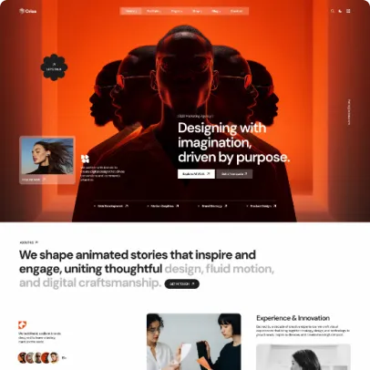

# Homepage

Homepage is the first page that users see when they visit your website. It is the most important page of your website.

## Create Homepage

If you are using the sample data of **Orisa**, the homepage is already created for you.

It's located in Admin -> Pages -> Home. You can skip this step.

To create a homepage, in admin panel, go to `Pages` and click on `Create` button.

In the `Create new page` page, fill in the following fields:

- **Title**: Enter the title of the page. For example, `Home`.
- **Permalink**: You can customize this permalink. But after set this page is homepage then permalink is `/`.
- **Content**: You have the option to customize the content or utilize our pre-defined [UI Block](./usage-ui-block.md).
- **Template**: Select `Homepage`.
- Other fields are optional, you can fill them if you want.

## Setup Homepage

After creating the homepage, you need to set it as the homepage of your website.

In admin panel, go to `Appearance` -> `Theme Options` -> `Page`, and select the homepage you just created in
the `Your homepage displays` field.

::: tip
If you are using the sample data of **Orisa**, the homepage is already created and set up for you.
:::

## Homepage Demo Presets

Orisa ships with **15 homepage demo presets**. You choose one when installing the script.

| # | Preset Name | Description |
|---|-------------|-------------|
| 1 | **Creative Agency** | Bold hero with video background, service tags, and portfolio grid |
| 2 | **Digital Agency** | Clean layout with animated stats and team showcase |
| 3 | **Marketing Agency** | CTA-focused design with pricing plans and blog posts |
| 4 | **AI & Tech** | Futuristic style with gradient accents and skills carousel |
| 5 | **Personal Creative** | Minimal portfolio layout with social links and about section |
| 6 | **Branding Studio** | Giant wordmark hero, stacking philosophy cards, case studies and brand awards |
| 7 | **Startup Agency** | Split-color hero, hamburger inline menu, service accordion with physics capsules |
| 8 | **Interactive Studio** | Parallax photo hero, keyword marquee, pinned testimonial stage |
| 9 | **Modern Agency** | Oversized type hero, filterable work grid, team list with hover previews |
| 10 | **3D Studio** | Video hero with cursor image trail, pinned services and staggered team |
| 11 | **Motion Studio** | Full-bleed video hero with reel modal, depth service cards, scroll-driven CTA |
| 12 | **Minimal Portfolio** | Centered hero with tile marquee, stacking projects, pricing and FAQ |
| 13 | **Architecture Studio** | Slider hero with service thumbs, project spec sheets, process timeline |
| 14 | **Photography Studio** | Editorial hero, filterable gallery archive, press & awards ticker |
| 15 | **Fashion Agency** | Ripple hero card, 3D sticky project stack, flipping team cards |

### Choosing a Demo

The demo is selected **during installation**, on the demo selection step of the web installer. There is no demo
importer inside the admin panel.

Each demo is a complete database dump shipped in the `database/sample/` folder of the source code:

| Preset Name | Database file |
|-------------|---------------|
| **Creative Agency** | `database.sql` |
| **Digital Agency** | `database-orisa-digital-agency.sql` |
| **Marketing Agency** | `database-orisa-marketing-agency.sql` |
| **AI & Tech** | `database-orisa-ai-tech-agency.sql` |
| **Personal Creative** | `database-orisa-personal-creative.sql` |
| **Branding Studio** | `database-orisa-branding-studio.sql` |
| **Startup Agency** | `database-orisa-startup-agency.sql` |
| **Interactive Studio** | `database-orisa-interactive-studio.sql` |
| **Modern Agency** | `database-orisa-modern-agency.sql` |
| **3D Studio** | `database-orisa-3d-studio.sql` |
| **Motion Studio** | `database-orisa-motion-studio.sql` |
| **Minimal Portfolio** | `database-orisa-minimal-portfolio.sql` |
| **Architecture Studio** | `database-orisa-architecture-studio.sql` |
| **Photography Studio** | `database-orisa-photography-studio.sql` |
| **Fashion Agency** | `database-orisa-fashion-agency.sql` |

::: tip
Every preset is built from the same UI Blocks. Each new preset adds styles to existing blocks (for example
**Hero Banner** styles 7–16), so you can mix sections from different presets on any page. Header and footer
layouts are chosen in `Appearance` -> `Theme Options` -> `Header` / `Footer`.
:::

### Switching to a Different Demo

If the site is already installed and you want a different demo, you have two options.

**Re-run the installer:**

1. Drop all tables in your database.
2. Delete the file `storage/installed`.
3. Reload your site to start the installer again and pick the demo you want.

**Import the SQL file directly:**

1. Drop all tables in your database.
2. Import the matching file from `database/sample/` via phpMyAdmin or the `mysql` command line.
3. Confirm `APP_URL` and the database credentials in `.env` are correct.

::: warning
Each file is a full database dump, so importing one replaces **all** existing content, including your admin account.
The default admin account of the demo data is `admin` / `12345678`. Only do this on a fresh site, or back up your
database first.
:::

## Customize Homepage

The homepage or any other page can be customized using UI Block. A list of available
shortcodes can be found in [UI Block](./usage-ui-block.md#available-shortcodes).
