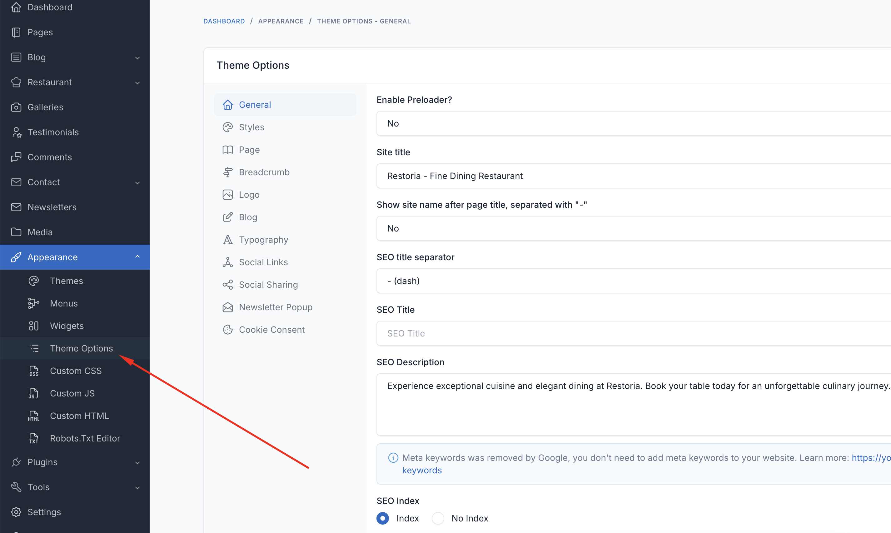
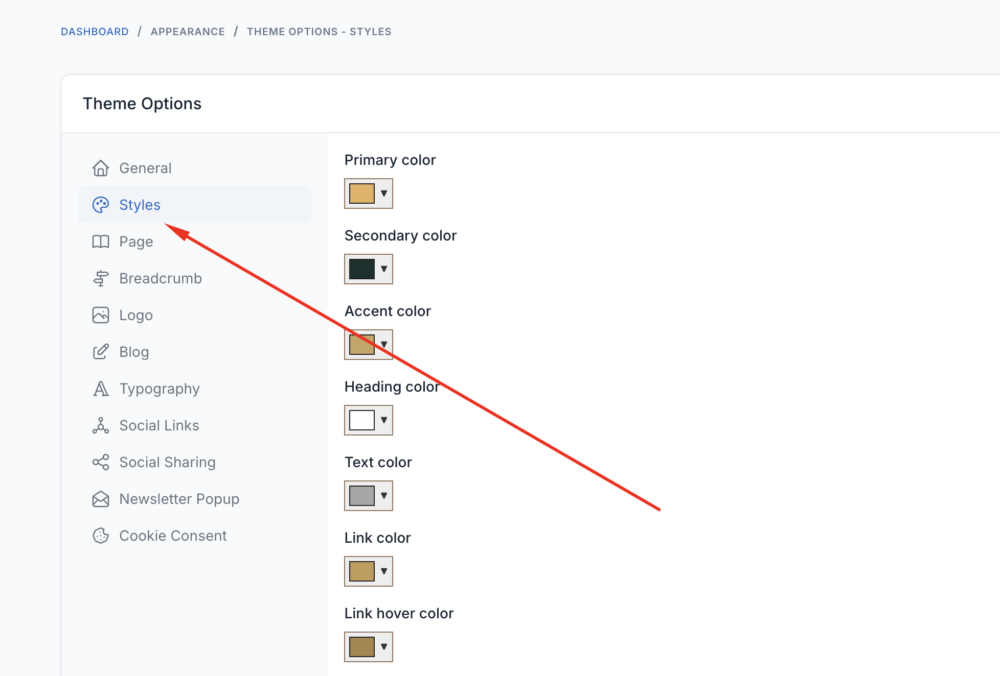
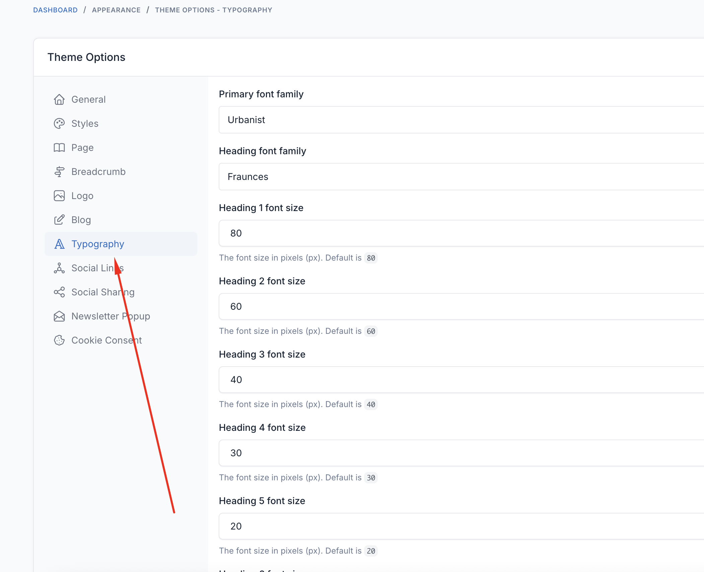
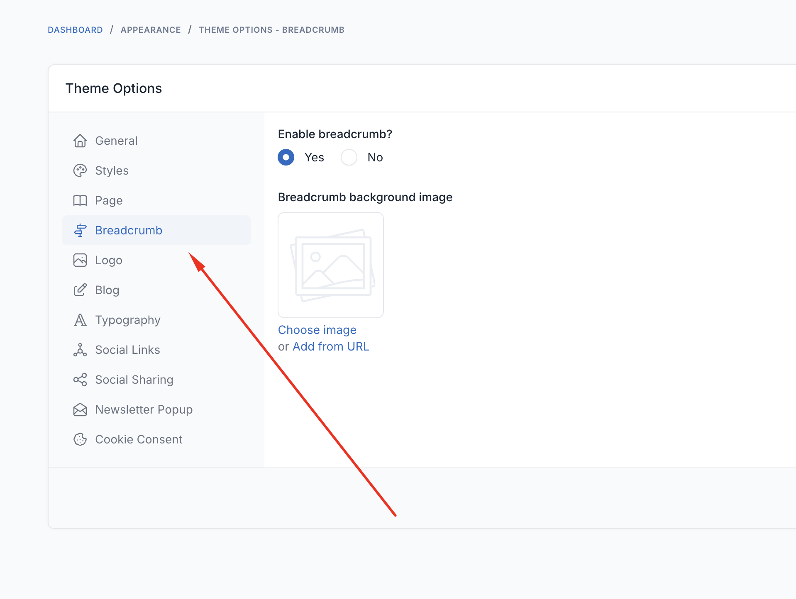

# Theme Options

Theme options allow you to customize every aspect of your Restoria restaurant website without touching any code. Access these settings through **Appearance** → **Theme Options** in your admin panel.

## Header

- **Show Header Top**: Show or hide the top info bar
- **Show Book Table Button**: Toggle the reservation button in the header
- **Header Background Color** / **Header Text Color**
- **Menu Background / Text / Hover Color**: Navigation menu colors

## Footer

- **Footer Background Color**, **Footer Text Color**, **Footer Link Color**, **Footer Link Hover Color**, **Footer Text Muted Color**

## General

Restaurant details used across the site: **Site Title**, **Restaurant Address**, **Email Address**, **Opening Hours**, **Booking Phone**, **Book Table URL**, **Hotline**, plus **404 Page Image**, **Enable Back to Top Button**, **Preloader Text** and **Enable Preloader Split Text Animation**.

## Styles

Customize the visual appearance of your restaurant website.

### Color Scheme
- **Primary Color**: Main brand color
- **Secondary Color**: Secondary brand color
- **Accent Color**: Accent/highlight color
- **Heading Color**: Titles and headings
- **Text Color**: Body text color
- **Link Color** and **Link Hover Color**: Hyperlink colors
- **Button Background / Text / Hover Colors**: Button styling
- **Border Color**: Borders and dividers

## Typography

Control fonts and text styling throughout your website.

Default fonts: `Urbanist` (primary) and `Fraunces` (heading).

### Font Families
- **Primary Font**: Main body text font
- **Heading Font**: Titles and headings

### Font Sizes
- **Body Text**: Base font size (14-18px recommended)
- **H1 - H6**: Heading sizes

## Breadcrumbs

Configure breadcrumb navigation for better user experience.

### Breadcrumb Settings
- **Enable Breadcrumbs**: Show/hide breadcrumbs
- **Background Image**: Upload custom background

