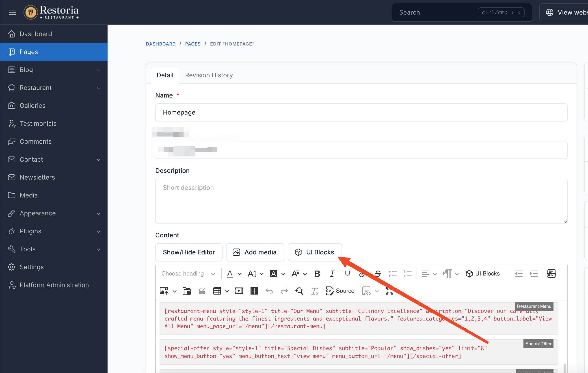
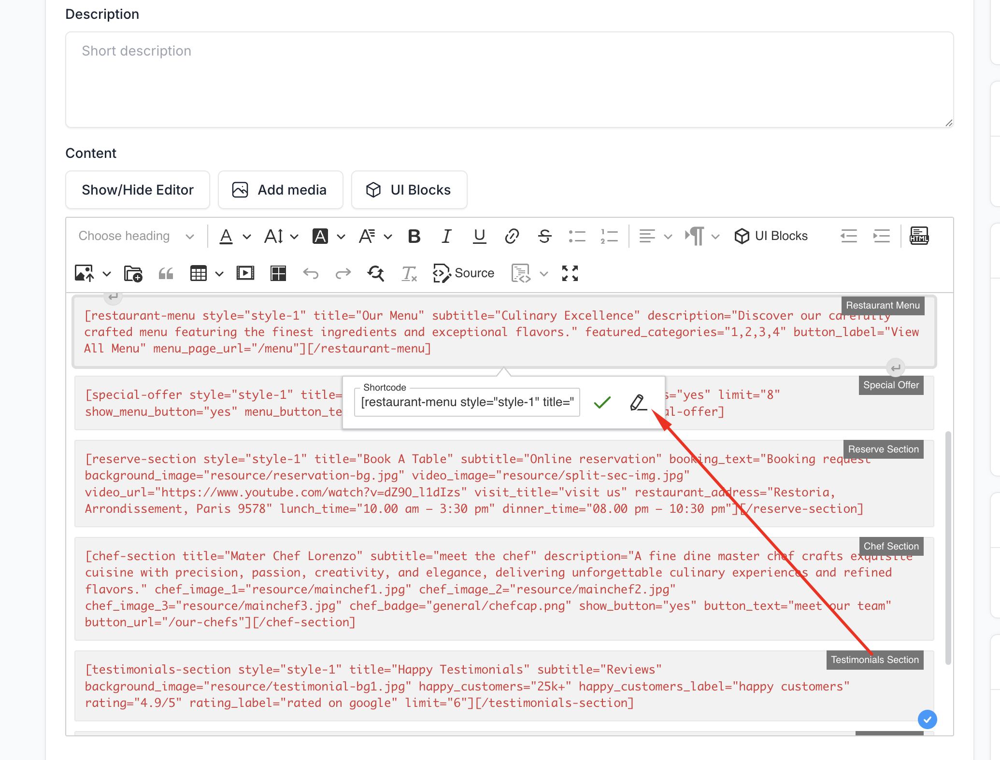

# UI Block

UI Blocks are pre-designed content sections that help you build beautiful restaurant pages quickly. Restoria provides specialized shortcodes tailored for the food and hospitality industry.

## How to Use UI Blocks

### Adding UI Blocks to Pages

1. Navigate to **Pages** in your admin panel
2. Create a new page or edit an existing one
3. Click the **UI Block** button in the editor
4. Select the desired shortcode from the list
5. Configure the shortcode settings
6. Click **Insert** to add it to your page

### Editing UI Blocks

To modify an existing UI block:

1. Click on the shortcode in the editor
2. Select **Edit** from the toolbar
3. Update the settings as needed
4. Click **Update** to save changes

## Available Shortcodes

Restoria ships with 12 UI Block shortcodes:

| Shortcode | Description |
|-----------|-------------|
| **Hero Banner** | Hero banner with slider and content |
| **About Section** | Restaurant about section |
| **Services Section** | Restaurant services with icons and descriptions |
| **Why Choose Us** | Features and statistics |
| **Restaurant Menu** | Restaurant menu categories (6 styles: Card Style with Corners, Grid with Images, Side by Side, Tabbed Menu, Two Columns, Menu Categories with Icons) |
| **Special Offer** | Special dishes (3 styles: Carousel, Split Layout with Side Image, Grid Layout) |
| **Reserve Section** | Reservation form (3 styles: Split Screen with Video, Centered with Background, Form with Side Images) |
| **Chef Section** | Chef information with images |
| **Gallery Section** | Gallery images |
| **Testimonials Section** | Customer testimonials with ratings |
| **News Section** | Latest blog posts |
| **Contact Section** | Contact information with contact form |
