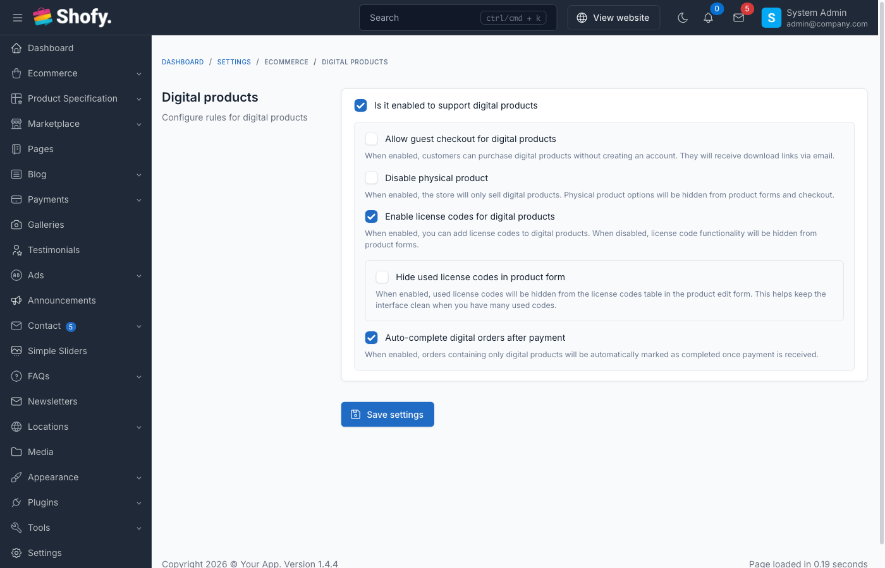

# Digital Products

Digital products allow you to sell downloadable files and software licenses. Customers receive download links and license codes automatically after purchase.

## Overview

Digital product features:

1. **Downloadable Files** - PDF, audio, video, software, etc.
2. **License Codes** - Unique keys for software activation
3. **Auto-Delivery** - Instant access after payment
4. **Auto-Complete** - Optionally complete digital-only orders right after payment
5. **Digital-only Store** - Optionally hide physical product options entirely

## Enable Digital Products

Navigate to `Ecommerce` -> `Settings` -> `Digital Products`.



### Configuration Options

| Setting | Description | Default |
|---------|-------------|---------|
| **Is it enabled to support digital products** | Turn on/off digital product features | Off |
| **Allow guest checkout for digital products** | Let guests purchase digital products without an account | Off |
| **Disable physical product** | Store sells digital products only; physical product options are hidden | Off |
| **Enable license codes for digital products** | Allow license codes on digital products | Off |
| **Hide used license codes in product form** | Hide used codes from the license codes table in the product form | Off |
| **Auto-complete digital orders after payment** | Orders containing only digital products are marked completed automatically after payment | Off |

Click **Save** after configuration.

::: warning
Digital products require a properly configured email system. Customers receive download links via email.
:::

## Creating Digital Products

### Step 1: Create Product

Navigate to `Ecommerce` -> `Products`, click the **Create** dropdown and choose **New digital product**.

1. Enter product details (name, description, price)
2. Configure pricing and settings
3. Click **Save**

### Step 2: Upload Digital Files

In the product edit page:

1. Scroll to the **Digital attachments** section
2. Click **Add Attachment** to upload a file, or **Add external link** for files hosted elsewhere (Google Drive, Dropbox, etc.)
3. For external links, enter the **File name**, the download URL and optionally the **File size**
4. Repeat for multiple files
5. Click **Save**

::: tip
For large files (>100MB), use external links to cloud storage instead of direct upload.
:::

### Supported File Types

Common file types for digital products:

| Category | Extensions |
|----------|-----------|
| Documents | PDF, DOC, DOCX, TXT, XLS, XLSX |
| Images | JPG, PNG, GIF, SVG, AI, PSD |
| Audio | MP3, WAV, FLAC, AAC |
| Video | MP4, AVI, MOV, MKV |
| Archives | ZIP, RAR, 7Z |
| Software | EXE, DMG, APK (use with caution) |

::: warning
Executable files (.exe, .dmg) may be blocked by some email providers. Consider providing download links via customer account instead.
:::

## License Code System

For software and activation-based products.

### Enable License Codes

1. Navigate to `Ecommerce` -> `Settings` -> `Digital Products`
2. Enable **Enable license codes for digital products**
3. Click **Save**

### Adding License Codes to Products

Edit the digital product and enable **Enable license code assignment for this product**, then choose a **License Code Assignment Method**:

**Method 1: Auto Generate**

The system generates a unique code automatically for each purchase. No codes need to be entered in advance.

**Method 2: Pick from List**

Use pre-entered codes. Click **Manage License Codes** in the product form to open the **License Code Management** page for that product, where you can:

- **Add License Code** - enter a single code
- **Generate Codes** - bulk-generate codes by quantity and format/pattern (`#` = number, `A` = uppercase, `a` = lowercase)
- **Import** - import codes from CSV/Excel via `Tools` -> `Export/Import Data` -> **Import Product License Codes** (columns: `product_id`, `license_code`)

Products with variations can have a separate code pool per variation.

### License Code Status

| Status | Description |
|--------|-------------|
| **Available** | Not yet assigned |
| **Used** | Assigned to customer |

::: tip
Generate more license codes than expected sales. System automatically assigns available codes on purchase.
:::

## Customer Download Process

### Purchase Flow

1. **Customer purchases** digital product
2. **Payment confirmed** - Order status = Completed
3. **System sends email** with:
   - Download links for each file
   - License codes (if enabled)
   - Access instructions
4. **Customer downloads** from email or account

### Download from Account

Customers can access downloads from their account:

1. Navigate to the customer account -> **Downloads**
2. View all purchased digital products
3. Click **Download** button
4. View license codes (if applicable)

Download links become available once the order is completed.

## Email Notifications

### Download Email Template

Customize the download email:

1. Navigate to `Settings` -> `Email`
2. In the **Ecommerce** section, edit **Download digital products** (sent with download links) or **Digital product license codes** (sent for digital products without downloadable files)
3. Available variables include:

| Variable | Description |
|----------|-------------|
| `customer_name` | Customer's name |
| `order_id` | Order reference number |
| `digital_product_list` | Table of purchased digital products |
| `digital_products` | Digital products data (for custom loops) |

4. Click **Save**

### Test Email

1. Create test order
2. Mark as completed
3. Check email delivery
4. Verify download links work

## Managing License Codes

License codes are managed per product: edit the product and click **Manage License Codes**. The table shows each code with its status (**Available** / **Used**). Used codes cannot be edited or deleted.

## Digital Product Variations

You can combine digital products with variations:

**Example:** Software with different editions

1. Create parent product (Software)
2. Add variations:
   - Basic Edition - $49
   - Pro Edition - $99
   - Enterprise Edition - $199
3. Upload different files per variation
4. Assign specific license codes per variation

Each variation can have:
- Different downloadable files
- Different license code pools
- Different pricing

## Digital + Physical Products

Customers can purchase both types in one order:

- **Digital products** - Deliver instantly
- **Physical products** - Ship separately
- **Order status** - Completed when physical items ship

## Refunds and Returns

There is no automatic access revocation for refunded digital orders. Download links and license codes already delivered are not revoked by the system, so set your refund policy accordingly.

## Security Best Practices

### File Storage

1. **Use secure storage** - Files stored outside public directory
3. **Monitor downloads** - Track suspicious activity
4. **Watermark files** - Add customer info to PDF/images

### License Code Security

1. **Use strong format** - UUID or complex alphanumeric
2. **One-time use** - Prevent code sharing
3. **Verify on activation** - Validate codes server-side
4. **Track activations** - Monitor how codes are used

### Preventing Piracy

1. **Track sharing** - Monitor if multiple IPs download
2. **Legal notices** - Include copyright in files
3. **Regular audits** - Review download patterns

## Troubleshooting

### Customer can't download files

1. **Check order status** - Must be "Completed"
2. **Verify email sent** - Check order emails
3. **Check the customer account** - Logged-in customers can re-download from **Downloads**

### License code not received

1. **Check email delivery** - Verify email sent
2. **Check spam folder** - Email may be filtered
3. **Verify codes available** - Check license code pool
4. **Manual assignment** - Admin can assign code manually

### File upload fails

1. **Check file size** - Verify server upload limits
2. **Check permissions** - Ensure `storage/app` is writable
3. **Use external link** - For very large files
4. **Check timeout** - Increase `max_execution_time`

## Import/Export Digital Products

### Export

Include digital product data:

```csv
product_type,generate_license_code
digital,1
```

### Import

Specify product type:

```csv
name,product_type,generate_license_code
Digital Product,digital,1
```

Upload files and license codes manually after import.

## Best Practices

1. **Test thoroughly** - Purchase and download before launch
2. **Use cloud storage** - For large files
3. **Backup files** - Maintain copies of all digital products
4. **Monitor downloads** - Watch for unusual patterns
5. **Update files** - Keep digital products current
6. **Clear instructions** - Include usage guides
7. **Prompt delivery** - Ensure instant access
8. **Quality files** - Provide professional, working files
9. **Customer support** - Help with download issues quickly

## Example: Complete Setup

**Product:** Premium WordPress Theme

**Configuration:**
1. **Product Type:** Digital
2. **Price:** $59
3. **Files:**
   - Theme ZIP file (15MB)
   - Documentation PDF (2MB)
   - Video tutorial link (external)
4. **License Codes:** 100 pre-generated codes
5. **Email:** Custom template with installation instructions

**Customer Experience:**
1. Purchase theme ($59)
2. Payment confirmed
3. Receive email with:
   - Download button for ZIP
   - Download button for PDF
   - Video tutorial link
   - License code: `XXXX-XXXX-XXXX-XXXX`
4. Downloads ZIP, activates with license code
5. Can re-download any time from the account **Downloads** page
