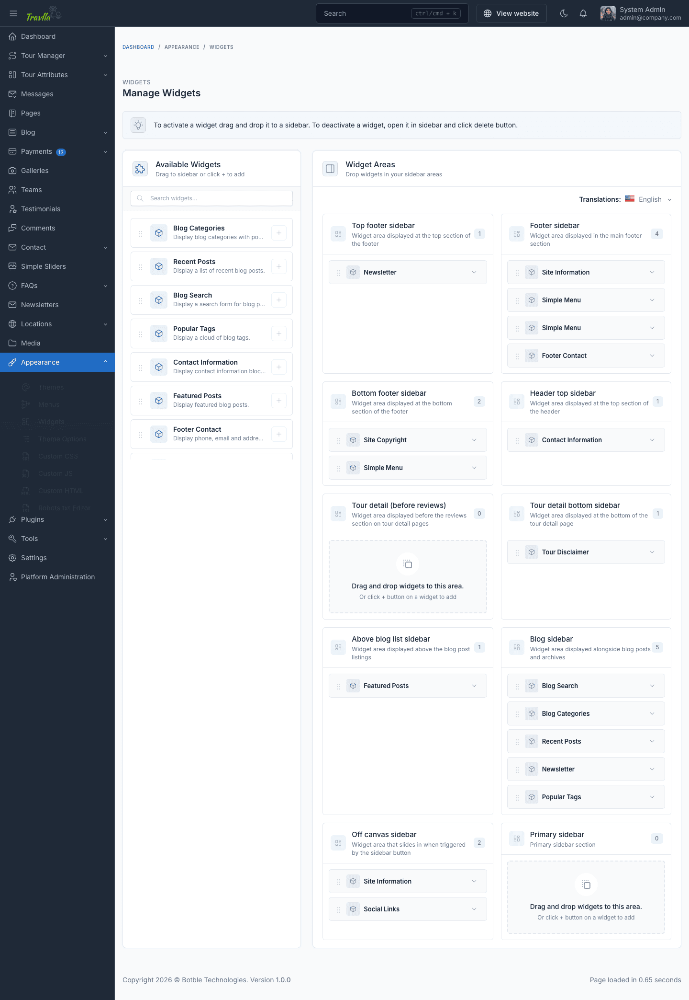

# Widgets

Travlla provides pre-made widget areas to help you customize the user interface and organize content strategically.

These sidebars offer flexibility in placement and functionality, allowing you to tailor the user experience on different
sections of your website.

## Manage Widgets

To manage the widgets, go to the `Appearance` -> `Widgets` menu in the admin panel.

To add a widget to a sidebar, drag and drop the widget from the left side to the sidebar area on the right side.

## Widget Areas

| Widget Area | Description |
|-------------|-------------|
| Tour detail (before reviews) | Displayed before the reviews section on tour detail pages |
| Tour detail bottom sidebar | Displayed at the bottom of the tour detail page |
| Above blog list sidebar | Displayed above the blog post listings |
| Blog sidebar | Displayed alongside blog posts and archives |

::: tip
The footer content (about text, contact details, social links) is configured in `Appearance` -> `Theme Options` -> `Footer`, not with widgets.
:::

## Blog Sidebar

In blog sidebar, you can use **Blog Search**, **Blog Posts**, **Galleries** widgets.

